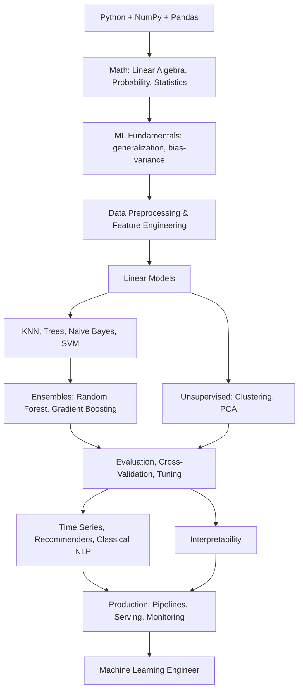
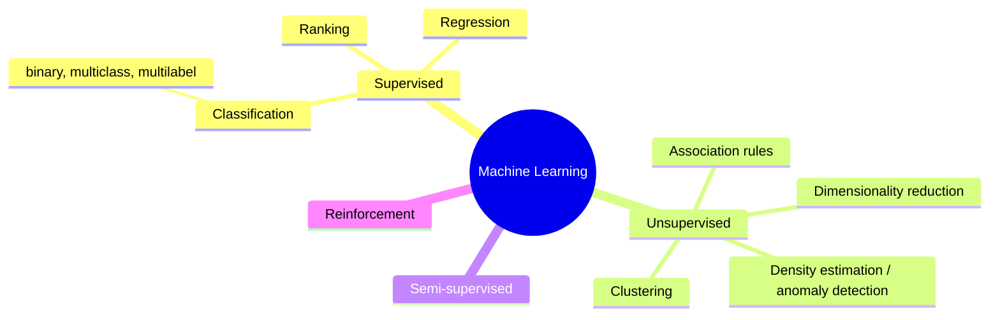
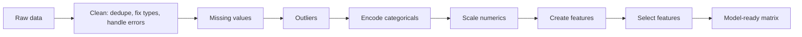
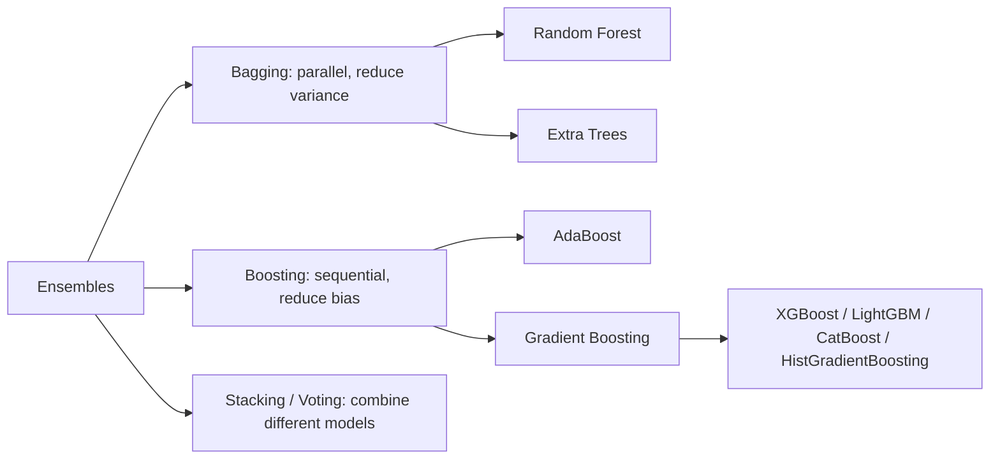
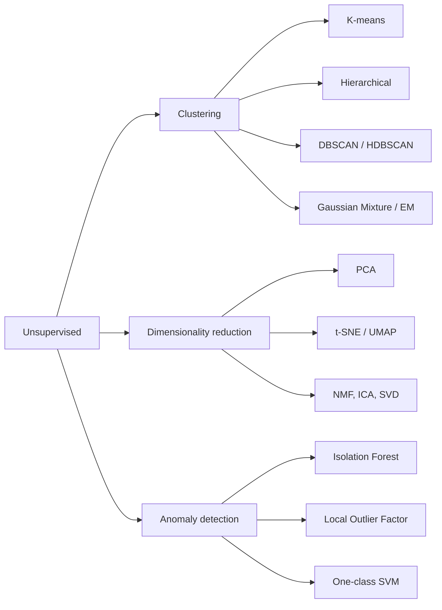
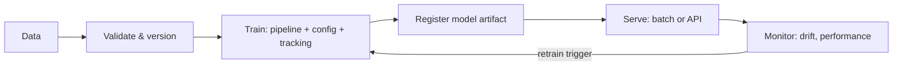

# Machine Learning: From Beginner to Machine Learning Engineer

> **A complete, end-to-end, blog-style guide to classical machine learning.** Start with no background, finish with the intuition, the math, and the code to design, train, evaluate, and ship ML systems. Every algorithm is built from scratch in NumPy first, then used properly with scikit-learn. 
<p align="center">
  <b>Beginner → Intermediate → Advanced → Engineer</b><br/>
  <i>Read it top-to-bottom, or jump to the part you need.</i>
</p>

---

## Table of Contents

| # | Part | What you'll learn |
|---|------|-------------------|
| 0 | [How to Use This Guide](#part-0-how-to-use-this-guide) | Roadmap, mindset, timeline |
| 1 | [Setting Up Your Environment](#part-1-setting-up-your-environment) | Python, conda, scikit-learn, Jupyter, project layout |
| 2 | [The Data Stack: NumPy, Pandas, Plotting](#part-2-the-data-stack-numpy-pandas-plotting) | Arrays, DataFrames, groupby, merge, EDA plots |
| 3 | [The Math You Actually Need](#part-3-the-math-you-actually-need) | Linear algebra, calculus, probability, statistics, information theory |
| 4 | [Machine Learning Fundamentals](#part-4-machine-learning-fundamentals) | Learning paradigms, the workflow, generalization, bias-variance |
| 5 | [Data Preprocessing & Feature Engineering](#part-5-data-preprocessing--feature-engineering) | Cleaning, encoding, scaling, pipelines, leakage |
| 6 | [Linear Models](#part-6-linear-models) | Linear/logistic regression from scratch, Ridge, Lasso, softmax |
| 7 | [k-Nearest Neighbors](#part-7-k-nearest-neighbors) | Distance, curse of dimensionality, KNN from scratch |
| 8 | [Decision Trees](#part-8-decision-trees) | Entropy, Gini, CART from scratch, pruning |
| 9 | [Ensembles: Bagging, Random Forests, Boosting](#part-9-ensembles-bagging-random-forests-boosting) | Random forest, AdaBoost, gradient boosting from scratch, XGBoost/LightGBM |
| 10 | [Support Vector Machines](#part-10-support-vector-machines) | Margins, hinge loss, kernels, SVM from scratch |
| 11 | [Naive Bayes & Probabilistic Classifiers](#part-11-naive-bayes--probabilistic-classifiers) | Gaussian/Multinomial NB from scratch, LDA/QDA, generative vs discriminative |
| 12 | [Unsupervised Learning](#part-12-unsupervised-learning) | K-means, hierarchical, DBSCAN, GMM/EM, PCA, t-SNE/UMAP, anomaly detection |
| 13 | [Model Evaluation & Selection](#part-13-model-evaluation--selection) | Metrics, cross-validation, tuning, imbalance, calibration |
| 14 | [Optimization & Learning Theory](#part-14-optimization--learning-theory) | Gradient descent, convexity, regularization, MLE/MAP, PAC in a page |
| 15 | [Time Series](#part-15-time-series) | Stationarity, lag features, ARIMA, backtesting |
| 16 | [Recommender Systems](#part-16-recommender-systems) | Collaborative filtering, matrix factorization from scratch |
| 17 | [Classical NLP](#part-17-classical-nlp) | Bag of words, TF-IDF, n-grams, topic models |
| 18 | [Interpretability](#part-18-interpretability) | Permutation importance, partial dependence, SHAP, LIME |
| 19 | [From Notebook to Production](#part-19-from-notebook-to-production) | Pipelines, persistence, serving, monitoring, reproducibility |
| 20 | [End-to-End Project Walkthrough](#part-20-end-to-end-project-walkthrough) | A complete, production-shaped ML project |
| 21 | [Career Roadmap & Projects](#part-21-career-roadmap--projects) | Portfolio, interviews, what to read |
| A | [Appendix: Cheat Sheets](#appendix-a-cheat-sheets) | Algorithm selection, sklearn API, hyperparameters |
| B | [Appendix: Glossary](#appendix-b-glossary) | Every term, briefly |
| C | [Appendix: Reading List](#appendix-c-books-courses--resources) | Books, courses, papers |

---

# Part 0: How to Use This Guide

## Who this is for

- **Complete beginners** who know some Python and want to understand machine learning properly, not just call `.fit()`.
- **Software engineers and analysts** moving into data science / ML engineering.
- **Students** preparing for exams, research, or interviews.
- **Deep learning practitioners** who skipped the classical foundations and keep getting beaten by gradient-boosted trees on tabular data.

## Philosophy

1. **Build it, then use it.** Every core algorithm is implemented from scratch in NumPy (so you know what is inside), then used via scikit-learn (so you know how it is done in practice).
2. **Data first.** Most real-world ML failures are data failures. We spend serious time on preprocessing, leakage, evaluation, and validation.
3. **Intuition + math.** Pictures and equations, side by side.
4. **Engineering matters.** Pipelines, reproducibility, serving, and monitoring are part of the job.

## The Roadmap



## Suggested timeline

| Weeks | Focus | Parts |
|-------|-------|-------|
| 1 | Setup, data stack, math | 1-3 |
| 2 | Fundamentals, preprocessing | 4-5 |
| 3 | Linear models, KNN | 6-7 |
| 4 | Trees, ensembles | 8-9 |
| 5 | SVM, Naive Bayes | 10-11 |
| 6 | Unsupervised learning | 12 |
| 7 | Evaluation, tuning, theory | 13-14 |
| 8 | Time series, recommenders, NLP | 15-17 |
| 9 | Interpretability, production | 18-19 |
| 10 | End-to-end project, portfolio | 20-21 |

## Mindset

- **Run every code block.** Change the numbers. Break it. Fix it.
- **Plot everything.** Distributions, residuals, learning curves, decision boundaries.
- **Always have a baseline.** Predict the mean / majority class first. Every model must beat it.
- **Be paranoid about leakage.** If a result looks too good, it is probably leaking.
- **Do the projects.** Every part ends with one.

---

# Part 1: Setting Up Your Environment

## 1.1 The toolchain at a glance

```
┌──────────────────────────────────────────────────────────────┐
│                         YOUR MACHINE                         │
│  ┌──────────┐  ┌────────────┐  ┌──────────────┐  ┌────────┐  │
│  │  Python  │  │ conda/venv │  │ scikit-learn │  │ pandas │  │
│  │  3.10+   │  │   (envs)   │  │  (models)    │  │ (data) │  │
│  └──────────┘  └────────────┘  └──────────────┘  └────────┘  │
│  ┌──────────┐  ┌────────────┐  ┌──────────────┐  ┌────────┐  │
│  │ Jupyter  │  │  VS Code   │  │ XGBoost /    │  │  git   │  │
│  │(explore) │  │   (code)   │  │ LightGBM     │  │        │  │
│  └──────────┘  └────────────┘  └──────────────┘  └────────┘  │
└──────────────────────────────────────────────────────────────┘
```

## 1.2 Install

```bash
# Miniconda: https://docs.conda.io/en/latest/miniconda.html
conda create -n ml python=3.11 -y
conda activate ml

pip install numpy pandas scipy scikit-learn matplotlib seaborn jupyterlab
pip install xgboost lightgbm catboost            # gradient boosting libraries
pip install statsmodels                          # statistics, time series
pip install optuna shap imbalanced-learn         # tuning, interpretability, imbalance
pip install joblib tqdm pyyaml
```

Verify:

```python
import sklearn, pandas, numpy, xgboost, lightgbm
print(sklearn.__version__, pandas.__version__, numpy.__version__)
```

## 1.3 Do you need a GPU?

No. Classical ML runs on CPU. A laptop with 8-16 GB RAM handles datasets up to a few million rows. For bigger data: sample first, then scale out (Spark, Dask, cloud).

## 1.4 Project structure template

```
my-ml-project/
├── data/
│   ├── raw/             # never modify
│   └── processed/
├── notebooks/           # exploration (numbered: 01_eda.ipynb, 02_baseline.ipynb)
├── src/
│   ├── data.py          # loading, splitting
│   ├── features.py      # feature engineering, pipelines
│   ├── train.py         # training entry point
│   ├── evaluate.py
│   └── predict.py
├── models/              # saved artifacts (gitignored)
├── configs/
├── tests/
├── requirements.txt
└── README.md
```

## 1.5 Reproducibility helper

```python
import random, os
import numpy as np

def seed_everything(seed: int = 42):
    random.seed(seed)
    os.environ["PYTHONHASHSEED"] = str(seed)
    np.random.seed(seed)

seed_everything(42)
# Also pass random_state=42 to every sklearn estimator / splitter that accepts it.
```

---

# Part 2: The Data Stack: NumPy, Pandas, Plotting

## 2.1 NumPy in 10 minutes

(The DL guide's Part 2 covers NumPy in depth. Here is the minimum for ML.)

```python
import numpy as np

X = np.random.randn(100, 5)          # 100 samples, 5 features
y = (X[:, 0] + 0.5 * X[:, 1] > 0).astype(int)

X.shape, X.mean(axis=0), X.std(axis=0)      # per-feature stats
(X - X.mean(0)) / X.std(0)                  # standardization via broadcasting
X @ np.random.randn(5, 1)                   # matrix multiply: a linear model
np.linalg.inv(X.T @ X) @ X.T @ y            # closed-form least squares (don't do this in prod)
X[y == 1]                                   # boolean mask filtering
np.argsort(X[:, 0])[:5]                     # indices of 5 smallest values
np.unique(y, return_counts=True)            # class counts
```

## 2.2 Pandas essentials

```python
import pandas as pd

# Load
df = pd.read_csv("data/raw/train.csv")           # also read_parquet, read_sql, read_excel, read_json
df.head(); df.info(); df.describe(include="all"); df.shape

# Select
df["age"]; df[["age", "fare"]]
df.loc[df["age"] > 30, ["name", "age"]]           # label-based, boolean mask
df.iloc[:5, :3]                                   # position-based
df.query("age > 30 and sex == 'female'")

# Missing values
df.isna().sum()
df["age"].fillna(df["age"].median())
df.dropna(subset=["fare"])

# Types & transforms
df["sex"] = df["sex"].astype("category")
df["log_fare"] = np.log1p(df["fare"])
df["title"] = df["name"].str.extract(r",\s*([^\.]+)\.")
df["date"] = pd.to_datetime(df["date"]); df["month"] = df["date"].dt.month

# Group / aggregate
df.groupby("pclass")["survived"].mean()
df.groupby(["pclass", "sex"]).agg(n=("survived", "size"), rate=("survived", "mean"))
df.pivot_table(values="survived", index="pclass", columns="sex", aggfunc="mean")

# Combine
pd.merge(df, other, on="id", how="left")          # SQL-style join
pd.concat([df1, df2], axis=0)                     # stack rows

# Sort / dedupe
df.sort_values(["pclass", "fare"], ascending=[True, False])
df.drop_duplicates(subset=["id"])

# Apply (slow; prefer vectorized ops)
df["fam"] = df.apply(lambda r: r["sibsp"] + r["parch"] + 1, axis=1)   # better: df["sibsp"] + df["parch"] + 1

# Save
df.to_parquet("data/processed/train.parquet")     # faster + typed; prefer over CSV
```

**Performance rules:** vectorize (`df[a] + df[b]`), avoid `iterrows`, use categoricals for low-cardinality strings, use Parquet.

## 2.3 Exploratory Data Analysis (EDA)

EDA is where you find the bugs in your data before they become bugs in your model.

```python
import matplotlib.pyplot as plt
import seaborn as sns

# Target distribution
df["target"].value_counts(normalize=True).plot.bar(); plt.title("class balance"); plt.show()

# Numeric features
df.hist(figsize=(14, 10), bins=30); plt.tight_layout(); plt.show()

# Feature vs target
sns.boxplot(data=df, x="target", y="fare"); plt.show()
sns.barplot(data=df, x="pclass", y="survived"); plt.show()

# Correlations
corr = df.select_dtypes("number").corr()
sns.heatmap(corr, cmap="coolwarm", center=0, annot=False); plt.show()

# Pairwise (small datasets)
sns.pairplot(df[["age", "fare", "pclass", "survived"]], hue="survived"); plt.show()

# Missingness pattern
sns.heatmap(df.isna(), cbar=False); plt.show()
```

### The EDA checklist

```
[ ] What is one row? (unit of analysis). Are there duplicates?
[ ] What is the target? Its distribution? Is it imbalanced?
[ ] For each feature: type, range, missing %, cardinality, obvious errors (age = 999)
[ ] Time: is there a time column? Does the distribution shift over time?
[ ] Leakage suspects: any feature that is a consequence of the target?
[ ] Relationships: which features correlate with the target? with each other?
[ ] Outliers: real or data-entry errors?
```

> **Exercise:** Load the Titanic dataset (`seaborn.load_dataset("titanic")`). Compute survival rate by class and sex, plot age distributions by survival, and find at least three data-quality issues.

---

# Part 3: The Math You Actually Need

Working fluency, not proofs. Each concept is tied to where it shows up in ML.

## 3.1 Linear algebra

### Vectors, dot products, norms

A sample is a vector **x** in R^d. The dot product measures alignment:

$$\mathbf{x}\cdot\mathbf{w} = \sum_i x_i w_i = \|\mathbf{x}\|\,\|\mathbf{w}\|\cos\theta$$

- A linear model's prediction is a dot product: ŷ = **w**·**x** + b.
- **L2 norm** ||x||₂ = sqrt(sum xᵢ²): Euclidean distance (KNN, K-means), Ridge penalty.
- **L1 norm** ||x||₁ = sum |xᵢ|: Manhattan distance, Lasso penalty (induces sparsity).
- **Cosine similarity**: dot / (norms); used in text and recommenders.

```python
x = np.array([1., 2., 3.]); w = np.array([0.5, -1., 2.])
x @ w                                                  # 4.5
np.linalg.norm(x), np.linalg.norm(x, ord=1)            # 3.74, 6.0
x @ w / (np.linalg.norm(x) * np.linalg.norm(w))        # cosine similarity
```

### Matrices

The design matrix **X** is n × d (rows = samples, columns = features). Key operations:

| Operation | NumPy | Where it appears |
|-----------|-------|------------------|
| Matmul | `X @ w` | every linear model |
| Transpose | `X.T` | normal equations, gradients |
| Inverse | `np.linalg.inv(A)` | closed-form OLS (use `solve` instead) |
| Solve Ax = b | `np.linalg.solve(A, b)` | Ridge closed form |
| Eigendecomposition | `np.linalg.eigh(C)` | PCA on covariance |
| SVD | `np.linalg.svd(X)` | PCA, low-rank, pseudo-inverse |
| Rank | `np.linalg.matrix_rank(X)` | multicollinearity |

### Eigenvalues and SVD (the heart of PCA)

Covariance matrix C = XᵀX/(n-1). Its eigenvectors are the directions of maximum variance; eigenvalues are the variance along them. SVD gives the same result directly from X and is numerically better.

```python
X = np.random.randn(200, 4) @ np.random.randn(4, 4)   # correlated features
Xc = X - X.mean(0)
U, S, Vt = np.linalg.svd(Xc, full_matrices=False)
explained = S**2 / (S**2).sum()
print("variance explained per component:", explained.round(3))
Z = Xc @ Vt[:2].T                                     # project to 2 principal components
```

## 3.2 Calculus

### Gradients and gradient descent

The gradient ∇L(θ) points uphill. We move downhill:

$$\theta \leftarrow \theta - \eta\,\nabla_\theta L(\theta)$$

```python
def f(w):       return (w[0] - 3)**2 + 2 * (w[1] + 1)**2
def grad_f(w):  return np.array([2 * (w[0] - 3), 4 * (w[1] + 1)])

w = np.zeros(2)
for _ in range(100):
    w -= 0.1 * grad_f(w)
print(w)   # -> [3, -1]
```

### The two gradients you must know by heart

For MSE loss L = (1/n) ||Xw - y||²:

$$\nabla_w L = \frac{2}{n} X^\top (Xw - y)$$

For logistic loss with p = σ(Xw):

$$\nabla_w L = \frac{1}{n} X^\top (p - y)$$

### Numerical gradient check

```python
def numerical_grad(f, w, eps=1e-6):
    g = np.zeros_like(w)
    for i in range(len(w)):
        wp = w.copy(); wp[i] += eps
        wm = w.copy(); wm[i] -= eps
        g[i] = (f(wp) - f(wm)) / (2 * eps)
    return g
print(numerical_grad(f, np.array([1., 1.])), grad_f(np.array([1., 1.])))
```

### Convexity

A function is convex if the line between any two points lies above the curve. Convex losses (MSE, logistic, hinge) have a single global minimum, so gradient descent is guaranteed to find it. Neural nets are not convex; most classical ML is.

```
   convex (one minimum)         non-convex (many)
       \       /                   \  /\    /\
        \     /                     \/  \  /  \
         \___/                           \/
```

## 3.3 Probability

### Basics

- P(A ∪ B) = P(A) + P(B) - P(A ∩ B)
- Conditional: P(A|B) = P(A ∩ B)/P(B)
- Independence: P(A ∩ B) = P(A)P(B)
- **Bayes' rule:**

$$P(\theta\mid D) = \frac{P(D\mid\theta)\,P(\theta)}{P(D)} \qquad \text{posterior} \propto \text{likelihood} \times \text{prior}$$

Naive Bayes is Bayes' rule with an independence assumption. Regularization is a prior. Bayesian optimization uses posteriors over the objective.

### Random variables

- **Expectation** E[X] = sum x·p(x); **Variance** Var[X] = E[(X - E[X])²]; **Covariance** Cov[X,Y] = E[(X-μx)(Y-μy)].
- **Correlation** = Cov / (σx σy), in [-1, 1]. Measures *linear* relationship only.

### Distributions you will meet

| Distribution | Models | Used in |
|--------------|--------|---------|
| Bernoulli(p) | one yes/no | logistic regression output |
| Binomial(n, p) | count of successes | A/B tests |
| Categorical | one of K classes | softmax, Naive Bayes |
| Poisson(λ) | counts per interval | Poisson regression |
| Gaussian N(μ, σ²) | continuous, symmetric | linear regression noise, GMM, LDA |
| Exponential | waiting times | survival analysis |
| Uniform | no preference | random init, random search |

```python
from scipy import stats
stats.norm(0, 1).pdf(1.0), stats.norm(0, 1).cdf(1.96)      # 0.242, 0.975
stats.binom(10, 0.5).pmf(5)                                # 0.246
x = stats.norm(5, 2).rvs(1000)                              # sample
```

### Maximum likelihood (why losses look the way they do)

Pick the parameters that make the observed data most probable:

$$\hat\theta = \arg\max_\theta \prod_i p(y_i \mid x_i;\theta) = \arg\max_\theta \sum_i \log p(y_i\mid x_i;\theta)$$

- Gaussian noise on y -> maximizing likelihood = **minimizing MSE**.
- Bernoulli y -> maximizing likelihood = **minimizing log loss (cross-entropy)**.
- Adding a Gaussian prior on w -> **Ridge**. Laplace prior -> **Lasso**. (That is MAP estimation.)

## 3.4 Statistics

### Descriptive

Mean, median (robust to outliers), mode, variance, std, quantiles, IQR, skew, kurtosis.

```python
s = df["fare"]
s.mean(), s.median(), s.std(), s.quantile([.25, .5, .75]), s.skew()
```

### Central Limit Theorem

The mean of n i.i.d. samples is approximately Gaussian with std σ/sqrt(n), regardless of the original distribution. This is why we can put confidence intervals on model metrics.

```python
# Bootstrap confidence interval for a metric
def bootstrap_ci(metric_fn, y_true, y_pred, n=1000, alpha=0.05, seed=0):
    rng = np.random.default_rng(seed); vals = []
    for _ in range(n):
        idx = rng.integers(0, len(y_true), len(y_true))
        vals.append(metric_fn(y_true[idx], y_pred[idx]))
    return np.percentile(vals, [100 * alpha / 2, 100 * (1 - alpha / 2)])
```

### Hypothesis testing (enough for ML)

- **Null hypothesis** H0: "no effect". **p-value**: probability of seeing data at least this extreme if H0 is true. Reject if p < α (0.05 by convention).
- **t-test:** compare means of two groups (`stats.ttest_ind`). **Paired t-test** to compare two models across the same CV folds.
- **Chi-squared:** association between categorical variables (`stats.chi2_contingency`).
- **Multiple comparisons:** testing 20 features at α = 0.05 will find 1 "significant" by chance. Use Bonferroni / FDR correction.
- Correlation is not causation. Confounders exist. Randomized experiments (A/B tests) are the gold standard.

```python
from scipy import stats
a = np.array([0.81, 0.83, 0.80, 0.82, 0.84])   # model A accuracy on 5 folds
b = np.array([0.79, 0.82, 0.79, 0.81, 0.82])   # model B
print(stats.ttest_rel(a, b))                    # paired test
```

## 3.5 Information theory

- **Entropy** H(p) = -sum p log p: uncertainty. Max when uniform. Used for decision tree splits.
- **Gini impurity** 1 - sum p²: cheaper alternative to entropy (CART default).
- **Cross-entropy** H(p, q) = -sum p log q: the log-loss metric.
- **KL divergence** KL(p||q) = sum p log(p/q): how different two distributions are. Used in t-SNE, variational methods, drift detection.
- **Mutual information** I(X;Y): how much knowing X reduces uncertainty about Y. Used for feature selection (`mutual_info_classif`).

```python
def entropy(p):  p = p[p > 0]; return -(p * np.log2(p)).sum()
def gini(p):     return 1 - (p**2).sum()
p = np.array([0.5, 0.5]);  print(entropy(p), gini(p))   # 1.0, 0.5 (max impurity)
p = np.array([0.9, 0.1]);  print(entropy(p), gini(p))   # 0.47, 0.18
```

## 3.6 Math -> code map

| Math | Code |
|------|------|
| ŷ = Xw + b | `X @ w + b` |
| σ(z) = 1/(1+e^-z) | `1 / (1 + np.exp(-z))` or `scipy.special.expit` |
| softmax(z) | `scipy.special.softmax(z, axis=1)` |
| ∇w MSE | `2/n * X.T @ (X @ w - y)` |
| (XᵀX)^-1 Xᵀ y | `np.linalg.lstsq(X, y, rcond=None)[0]` |
| Entropy of label vector | `entropy(np.bincount(y) / len(y))` |
| Pairwise distances | `scipy.spatial.distance.cdist(A, B)` |

> **Exercise:** Derive the gradient of the logistic loss by hand and verify it numerically. Then show that adding (λ/2)||w||² to the MSE loss changes the closed-form solution to w = (XᵀX + λI)^-1 Xᵀy.

---

# Part 4: Machine Learning Fundamentals

## 4.1 What is machine learning?

A program that improves at a task with experience (data). Concretely: choose a **model family** f_θ, a **loss** L measuring how wrong f_θ is on data, and an **optimizer** that finds θ minimizing L. Then check that it also works on **new** data (generalization).

```
          ┌──────────┐    prediction ŷ    ┌────────────┐
   x ───> │  f_θ(x)  │ ─────────────────> │  Loss      │ <─── true y
          └──────────┘                    │  L(ŷ, y)   │
               ▲                          └─────┬──────┘
               │          update θ              │
               └────────────────────────────────┘
```

## 4.2 The learning paradigms



| Paradigm | Data | Goal | Examples |
|----------|------|------|----------|
| Supervised | (x, y) pairs | predict y from x | spam filter, house prices, churn |
| Unsupervised | x only | find structure | customer segments, compression, outliers |
| Semi-supervised | few labeled + many unlabeled | use both | label propagation |
| Reinforcement | actions, rewards | maximize reward | games, bidding, control |

## 4.3 The ML workflow


Step 1 is the one people skip: **what exactly are we predicting, for whom, and what metric reflects business value?** A fraud model optimized for accuracy on 0.1% fraud is worthless.

## 4.4 Train / validation / test

```
┌────────────────────────────── all labeled data ──────────────────────────────┐
│ ████████████████████████ train (60-80%) ███████ │ validation (10-20%) │ test (10-20%) │
└─────────────────────────────────────────────────┴─────────────────────┴───────────────┘
   fit parameters                                  pick model /            final honest
                                                   hyperparameters         estimate, touch once
```

```python
from sklearn.model_selection import train_test_split
X_trainval, X_test, y_trainval, y_test = train_test_split(X, y, test_size=0.2, stratify=y, random_state=42)
X_train, X_val, y_train, y_val = train_test_split(X_trainval, y_trainval, test_size=0.25, stratify=y_trainval, random_state=42)
```

- `stratify=y` keeps class proportions identical across splits.
- **Time series:** never shuffle; split by time (train on past, test on future).
- **Grouped data** (multiple rows per patient/user): split by group so the same entity is not in both train and test.

## 4.5 Your first models: baselines

Always start here. If your fancy model cannot beat these, something is wrong.

```python
from sklearn.dummy import DummyClassifier, DummyRegressor
DummyClassifier(strategy="most_frequent").fit(X_train, y_train).score(X_val, y_val)
DummyRegressor(strategy="mean").fit(X_train, y_train).score(X_val, y_val)
```

## 4.6 Overfitting, underfitting, bias-variance

```
   error
     │
     │ \                                          validation error
     │  \                                     ___/
     │   \                               ____/
     │    \_____             ___________/
     │          ‾‾‾‾‾‾‾‾‾‾‾‾‾       <- sweet spot
     │                        ‾‾‾‾‾‾‾‾‾‾‾‾‾‾‾‾‾‾‾‾‾‾‾‾‾‾ training error
     └────────────────────────────────────────────────> model complexity
        underfitting   │                 │  overfitting
        (high bias)    │                 │  (high variance)
```

**Bias** = error from wrong assumptions (model too simple). **Variance** = error from sensitivity to the particular training sample (model too flexible). **Noise** = irreducible.

$$\mathbb{E}[(y - \hat f(x))^2] = \underbrace{(\mathbb{E}[\hat f(x)] - f(x))^2}_{\text{bias}^2} + \underbrace{\mathbb{E}[(\hat f(x) - \mathbb{E}[\hat f(x)])^2]}_{\text{variance}} + \sigma^2$$

```python
# See it: polynomial degree vs train/val error
from sklearn.preprocessing import PolynomialFeatures
from sklearn.linear_model import LinearRegression
from sklearn.pipeline import make_pipeline
from sklearn.metrics import mean_squared_error

rng = np.random.default_rng(0)
x = np.sort(rng.uniform(-3, 3, 60)); y = np.sin(x) + rng.normal(0, 0.3, 60)
xt, xv, yt, yv = train_test_split(x, y, test_size=0.3, random_state=0)
for deg in [1, 3, 9, 15]:
    m = make_pipeline(PolynomialFeatures(deg), LinearRegression()).fit(xt[:, None], yt)
    print(f"deg {deg:2d}  train {mean_squared_error(yt, m.predict(xt[:, None])):.3f}  val {mean_squared_error(yv, m.predict(xv[:, None])):.3f}")
# deg 1: underfits (both high). deg 3: good. deg 15: overfits (train tiny, val large).
```

| Symptom | Diagnosis | Fixes |
|---------|-----------|-------|
| Train error high, val error high | underfitting / high bias | more features, more complex model, less regularization, fix bugs |
| Train error low, val error high | overfitting / high variance | more data, regularization, simpler model, feature selection, ensembles |
| Both low, production bad | distribution shift or leakage | audit the pipeline, re-split by time/group |

## 4.7 Cross-validation

A single validation split is noisy. k-fold CV uses every sample for validation exactly once.

```
  5-fold CV:   data = [ F1 | F2 | F3 | F4 | F5 ]
  round 1:  train F2..F5, validate F1
  round 2:  train F1,F3..F5, validate F2
  ...
  score = mean (and std!) of the 5 validation scores
```

```python
from sklearn.model_selection import cross_val_score, StratifiedKFold
cv = StratifiedKFold(n_splits=5, shuffle=True, random_state=42)
scores = cross_val_score(model, X_trainval, y_trainval, cv=cv, scoring="roc_auc")
print(f"AUC {scores.mean():.4f} +/- {scores.std():.4f}")
```

Report the standard deviation. A difference of 0.002 between models with std 0.01 is noise.

## 4.8 Loss vs metric

- **Loss**: what the optimizer minimizes (must be differentiable / optimizable): MSE, log loss, hinge.
- **Metric**: what you actually care about: accuracy, F1, AUC, revenue. Often not differentiable.
- Choose the metric from the business problem first, then pick a loss that is a good proxy.

## 4.9 The no-free-lunch principle

No algorithm is best for every problem. In practice on **tabular data**: gradient-boosted trees usually win; linear models win when data is small or features are many and sparse; KNN/SVM shine on small, clean, low-dimensional data. Always try several.

> **Project:** On the Titanic dataset, build a `DummyClassifier` baseline, then logistic regression, with 5-fold stratified CV. Plot the bias-variance curve for a decision tree by varying `max_depth` from 1 to 20 and recording train vs CV accuracy.

---

# Part 5: Data Preprocessing & Feature Engineering

"Garbage in, garbage out." Feature engineering is where most of the practical wins in classical ML come from.

## 5.1 The preprocessing map



**Golden rule: fit every transformation on the training set only, then apply to validation/test.** Anything else is leakage.

## 5.2 Missing values

```python
df.isna().mean().sort_values(ascending=False)    # fraction missing per column
```

| Strategy | When |
|----------|------|
| Drop rows | few rows affected, missing at random |
| Drop column | mostly missing and uninformative |
| Impute mean/median | numeric, low missingness (median is robust) |
| Impute mode / "missing" category | categorical |
| Add a "was_missing" indicator | missingness itself is informative (very often!) |
| Model-based (KNN, iterative) | when relationships matter and data is small |
| Let the model handle it | LightGBM/XGBoost/CatBoost handle NaN natively |

```python
from sklearn.impute import SimpleImputer, KNNImputer
num_imp = SimpleImputer(strategy="median", add_indicator=True)
cat_imp = SimpleImputer(strategy="constant", fill_value="missing")
```

## 5.3 Outliers

Detect: z-score (|z| > 3), IQR rule (outside Q1 - 1.5 IQR, Q3 + 1.5 IQR), Isolation Forest.

```python
q1, q3 = df["fare"].quantile([.25, .75]); iqr = q3 - q1
mask = (df["fare"] < q1 - 1.5 * iqr) | (df["fare"] > q3 + 1.5 * iqr)
```

Treat: remove (if data error), clip/winsorize (`np.clip`), log-transform, or use robust models (trees do not care).

## 5.4 Encoding categorical variables

```
  color: red, green, blue
  one-hot:        red=[1,0,0] green=[0,1,0] blue=[0,0,1]      (linear models, KNN, SVM)
  ordinal:        small=0 medium=1 large=2                    (only when order is real)
  target encode:  red -> mean(y | color=red)                  (high-cardinality; must be done inside CV!)
  frequency:      red -> count(red)/n
  hashing:        hash(red) % 1024                            (huge vocabularies, streaming)
```

```python
from sklearn.preprocessing import OneHotEncoder, OrdinalEncoder
ohe = OneHotEncoder(handle_unknown="ignore", sparse_output=False, min_frequency=10)   # rare -> "infrequent"
ord_enc = OrdinalEncoder(categories=[["small", "medium", "large"]])

# Target encoding with CV to avoid leakage (sklearn >= 1.3)
from sklearn.preprocessing import TargetEncoder
te = TargetEncoder(target_type="binary", cv=5, smooth="auto")
```

Tree libraries (LightGBM, CatBoost) accept categorical columns directly and usually do better than one-hot for high cardinality.

## 5.5 Scaling numeric features

| Scaler | Formula | Use |
|--------|---------|-----|
| `StandardScaler` | (x - mean)/std | default for linear models, SVM, KNN, PCA |
| `MinMaxScaler` | (x - min)/(max - min) | bounded inputs, neural nets |
| `RobustScaler` | (x - median)/IQR | heavy outliers |
| `PowerTransformer` / `np.log1p` | make skewed data Gaussian-ish | incomes, prices, counts |
| none | | tree-based models (invariant to monotonic transforms) |

```python
from sklearn.preprocessing import StandardScaler
sc = StandardScaler().fit(X_train)          # fit on train only
X_train_s, X_val_s = sc.transform(X_train), sc.transform(X_val)
```

## 5.6 Creating features

This is the creative part. Ideas that work again and again:

```python
# Numeric interactions and ratios
df["fare_per_person"] = df["fare"] / (df["sibsp"] + df["parch"] + 1)
df["area_x_rooms"] = df["area"] * df["rooms"]

# Binning (turns a nonlinear effect into something a linear model can capture)
df["age_bin"] = pd.cut(df["age"], bins=[0, 12, 18, 35, 60, 120], labels=False)

# Dates
d = pd.to_datetime(df["timestamp"])
df["hour"], df["dow"], df["month"] = d.dt.hour, d.dt.dayofweek, d.dt.month
df["is_weekend"] = (d.dt.dayofweek >= 5).astype(int)
df["days_since_signup"] = (d - pd.to_datetime(df["signup"])).dt.days
# cyclic encoding so hour 23 is close to hour 0
df["hour_sin"], df["hour_cos"] = np.sin(2 * np.pi * df["hour"] / 24), np.cos(2 * np.pi * df["hour"] / 24)

# Text
df["name_len"] = df["name"].str.len()
df["title"] = df["name"].str.extract(r",\s*([^\.]+)\.")

# Aggregations (group statistics; compute on TRAIN only, then merge)
agg = train.groupby("user_id")["amount"].agg(["mean", "std", "count"]).add_prefix("user_amount_")
df = df.merge(agg, left_on="user_id", right_index=True, how="left")

# Polynomial features for linear models
from sklearn.preprocessing import PolynomialFeatures
PolynomialFeatures(degree=2, include_bias=False)

# Domain knowledge beats everything: BMI = weight/height^2, speed = distance/time, ...
```

## 5.7 Feature selection

| Method | Idea | Tool |
|--------|------|------|
| Filter | score each feature independently | `SelectKBest(f_classif / mutual_info_classif)`, correlation threshold, `VarianceThreshold` |
| Wrapper | search subsets using model performance | `RFE`, `SequentialFeatureSelector` |
| Embedded | model does it during training | Lasso (zero coefficients), tree feature importances, `SelectFromModel` |
| Permutation importance | shuffle a feature, measure drop | `permutation_importance` (Part 18) |

```python
from sklearn.feature_selection import SelectKBest, mutual_info_classif, SelectFromModel
from sklearn.linear_model import LassoCV
selector = SelectFromModel(LassoCV(cv=5), threshold="median")
```

Remove features that are: constant, duplicated, nearly perfectly correlated with another, or leaking.

## 5.8 Pipelines and ColumnTransformer (the professional way)

Everything above must happen inside a `Pipeline` so it is (a) fit on train only, (b) applied identically at inference, (c) tunable with CV.

```python
from sklearn.pipeline import Pipeline
from sklearn.compose import ColumnTransformer
from sklearn.preprocessing import StandardScaler, OneHotEncoder
from sklearn.impute import SimpleImputer
from sklearn.linear_model import LogisticRegression

num_cols = ["age", "fare", "sibsp", "parch"]
cat_cols = ["sex", "embarked", "pclass"]

numeric = Pipeline([("impute", SimpleImputer(strategy="median", add_indicator=True)),
                    ("scale", StandardScaler())])
categorical = Pipeline([("impute", SimpleImputer(strategy="constant", fill_value="missing")),
                        ("onehot", OneHotEncoder(handle_unknown="ignore"))])

pre = ColumnTransformer([("num", numeric, num_cols),
                         ("cat", categorical, cat_cols)], remainder="drop")

clf = Pipeline([("pre", pre), ("model", LogisticRegression(max_iter=1000))])
clf.fit(X_train, y_train)
print(clf.score(X_val, y_val))

# Feature names after transformation
clf[:-1].get_feature_names_out()
```

```
   raw DataFrame
        │
        ▼ ColumnTransformer
   ┌────────────┬────────────┐
   │ numeric    │ categorical│
   │ impute     │ impute     │
   │ scale      │ one-hot    │
   └─────┬──────┴──────┬─────┘
         └──── concat ─┘
                │
                ▼
             model
```

### Custom transformers

```python
from sklearn.base import BaseEstimator, TransformerMixin

class FamilyFeatures(BaseEstimator, TransformerMixin):
    def fit(self, X, y=None): return self
    def transform(self, X):
        X = X.copy()
        X["family_size"] = X["sibsp"] + X["parch"] + 1
        X["is_alone"] = (X["family_size"] == 1).astype(int)
        return X
# Use: Pipeline([("fam", FamilyFeatures()), ("pre", pre), ("model", ...)])
```

## 5.9 Data leakage: the silent killer

Leakage = information about the target sneaking into features or into the fitting process.

| Type | Example | Fix |
|------|---------|-----|
| Target leakage | "refund_issued" as a feature for predicting fraud | remove features that happen after the target |
| Train/test contamination | scaling with full-data mean | fit transformers inside the pipeline on train only |
| Duplicates | same row in train and test | dedupe before splitting |
| Temporal | using future rows to predict past | time-based split |
| Group | same patient in train and test | `GroupKFold` |
| Target encoding without CV | encodes each row with its own label | `TargetEncoder(cv=...)` |

**Smell test:** if a single feature gives 99% accuracy, investigate it before celebrating.

> **Project:** Build a full `Pipeline` + `ColumnTransformer` for the Titanic data including a custom transformer. Measure CV accuracy with and without each engineered feature (ablation). Introduce a deliberate leak (fit the scaler on all data) and show that CV becomes over-optimistic.

---

# Part 6: Linear Models

Linear models are fast, interpretable, hard to overfit with regularization, and a strong baseline for everything. Understand them deeply.

## 6.1 Linear regression

Model: ŷ = w·x + b = Xw (absorb b by adding a column of 1s). Loss: MSE.

$$L(w) = \frac{1}{n}\|Xw - y\|^2$$

### Closed form (normal equations)

Set gradient to zero: Xᵀ(Xw - y) = 0, so **w = (XᵀX)^-1 Xᵀ y**.

```python
X1 = np.c_[np.ones(len(X)), X]                       # add bias column
w = np.linalg.solve(X1.T @ X1, X1.T @ y)             # never use inv() directly
# or: w = np.linalg.lstsq(X1, y, rcond=None)[0]      # SVD-based, most stable
```

Cost O(nd² + d³): fine up to ~10k features. Beyond that, or for streaming, use gradient descent.

### Gradient descent from scratch

```python
class LinearRegressionGD:
    def __init__(self, lr=0.01, epochs=1000, l2=0.0):
        self.lr, self.epochs, self.l2 = lr, epochs, l2
    def fit(self, X, y):
        n, d = X.shape
        self.w = np.zeros(d); self.b = 0.0
        for _ in range(self.epochs):
            y_hat = X @ self.w + self.b
            err = y_hat - y
            dw = 2 / n * X.T @ err + 2 * self.l2 * self.w     # L2 term = Ridge
            db = 2 / n * err.sum()
            self.w -= self.lr * dw; self.b -= self.lr * db
        return self
    def predict(self, X): return X @ self.w + self.b

from sklearn.datasets import make_regression
X, y = make_regression(n_samples=500, n_features=5, noise=10, random_state=0)
X = (X - X.mean(0)) / X.std(0)                        # GD needs scaled features
m = LinearRegressionGD(lr=0.05, epochs=500).fit(X, y)
from sklearn.linear_model import LinearRegression
print(np.allclose(m.w, LinearRegression().fit(X, y).coef_, atol=0.5))
```

### Assumptions (and what breaks when they fail)

| Assumption | If violated | Check |
|------------|-------------|-------|
| Linearity | biased predictions | residuals vs fitted plot shows pattern |
| Independent errors | wrong standard errors | time series: Durbin-Watson |
| Constant variance (homoscedastic) | wrong CIs | funnel shape in residual plot |
| Normal errors | CIs off (predictions fine) | Q-Q plot |
| No multicollinearity | unstable coefficients | VIF > 10 |

```python
# Residual diagnostics
res = y_val - model.predict(X_val)
plt.scatter(model.predict(X_val), res, s=5); plt.axhline(0, c="r"); plt.xlabel("fitted"); plt.ylabel("residual")
```

## 6.2 Polynomial regression

Linear in the *parameters*, nonlinear in the *inputs*: add x², x³, x₁x₂ as features. Powerful but overfits fast; pair with regularization.

```python
poly_ridge = make_pipeline(StandardScaler(), PolynomialFeatures(3), Ridge(alpha=1.0))
```

## 6.3 Regularization: Ridge, Lasso, ElasticNet

Add a penalty on the size of w to the loss. Shrinks coefficients, reduces variance, handles multicollinearity.

| Name | Penalty | Effect | Closed form? |
|------|---------|--------|--------------|
| **Ridge** (L2) | α sum wᵢ² | shrinks all coefficients smoothly | yes: (XᵀX + αI)^-1 Xᵀy |
| **Lasso** (L1) | α sum abs(wᵢ) | drives some coefficients to exactly 0 (feature selection) | no (coordinate descent) |
| **ElasticNet** | mix of both | sparse + stable with correlated features | no |

```
   L2 ball (circle)             L1 ball (diamond)
        ___                          /\
      /     \   loss contours       /  \   contour touches the
     |   •   |  touch the circle   <  •  >  diamond at a CORNER
      \ ___ /   anywhere            \  /   -> some w_i = 0 exactly
                                     \/
```

```python
from sklearn.linear_model import Ridge, Lasso, ElasticNet, RidgeCV, LassoCV
ridge = make_pipeline(StandardScaler(), RidgeCV(alphas=np.logspace(-3, 3, 20)))
lasso = make_pipeline(StandardScaler(), LassoCV(cv=5))
lasso.fit(X_train, y_train)
print("nonzero coefs:", (lasso[-1].coef_ != 0).sum())
```

**Always scale before regularizing**, otherwise the penalty depends on feature units.

## 6.4 Logistic regression (classification)

Squash the linear score through a sigmoid to get a probability:

$$p(y=1\mid x) = \sigma(w\cdot x + b) = \frac{1}{1 + e^{-(w\cdot x + b)}}$$

Loss: binary cross-entropy / log loss (= negative log-likelihood of Bernoulli):

$$L = -\frac{1}{n}\sum_i\left[y_i\log p_i + (1-y_i)\log(1-p_i)\right],\qquad \nabla_w L = \frac{1}{n}X^\top(p - y)$$

```
   p
 1 ┤              ____------
   │          _.-'
.5 ┤       _.'          decision boundary: w.x + b = 0  (p = 0.5)
   │   _.-'
 0 ┤--'
   └────────────┴──────────────> w.x + b
                0
```

### From scratch

```python
def sigmoid(z): return 1 / (1 + np.exp(-z))

class LogisticRegressionGD:
    def __init__(self, lr=0.1, epochs=1000, l2=0.0):
        self.lr, self.epochs, self.l2 = lr, epochs, l2
    def fit(self, X, y):
        n, d = X.shape; self.w = np.zeros(d); self.b = 0.0
        for _ in range(self.epochs):
            p = sigmoid(X @ self.w + self.b)
            dw = X.T @ (p - y) / n + self.l2 * self.w
            db = (p - y).mean()
            self.w -= self.lr * dw; self.b -= self.lr * db
        return self
    def predict_proba(self, X): return sigmoid(X @ self.w + self.b)
    def predict(self, X, thr=0.5): return (self.predict_proba(X) >= thr).astype(int)

from sklearn.datasets import load_breast_cancer
X, y = load_breast_cancer(return_X_y=True)
X = (X - X.mean(0)) / X.std(0)
Xt, Xv, yt, yv = train_test_split(X, y, test_size=0.2, stratify=y, random_state=0)
m = LogisticRegressionGD(lr=0.1, epochs=2000, l2=1e-3).fit(Xt, yt)
print("accuracy:", (m.predict(Xv) == yv).mean())     # ~0.97
```

### In scikit-learn

```python
from sklearn.linear_model import LogisticRegression
lr = make_pipeline(StandardScaler(), LogisticRegression(C=1.0, penalty="l2", max_iter=1000, class_weight="balanced"))
# C = 1/alpha : SMALLER C = STRONGER regularization
lr.fit(X_train, y_train)
lr.predict_proba(X_val)[:, 1]
```

### Interpreting coefficients

Each unit increase in xⱼ multiplies the **odds** p/(1-p) by e^(wⱼ). With standardized features, |wⱼ| ranks feature influence.

```python
coefs = pd.Series(lr[-1].coef_[0], index=feature_names).sort_values()
np.exp(coefs)      # odds ratios
```

## 6.5 Softmax (multinomial) regression

K classes, K weight vectors. p(y=k|x) = exp(wₖ·x) / sum_j exp(wⱼ·x). Loss: cross-entropy. `LogisticRegression` does this automatically for multiclass.

```python
def softmax(Z): Z = Z - Z.max(1, keepdims=True); e = np.exp(Z); return e / e.sum(1, keepdims=True)

class SoftmaxRegression:
    def __init__(self, lr=0.1, epochs=500): self.lr, self.epochs = lr, epochs
    def fit(self, X, y):
        n, d = X.shape; K = y.max() + 1
        self.W = np.zeros((d, K)); self.b = np.zeros(K)
        Y = np.eye(K)[y]                                    # one-hot
        for _ in range(self.epochs):
            P = softmax(X @ self.W + self.b)
            self.W -= self.lr * X.T @ (P - Y) / n
            self.b -= self.lr * (P - Y).mean(0)
        return self
    def predict(self, X): return (X @ self.W + self.b).argmax(1)
```

One-vs-rest (train K binary classifiers) is the alternative; needed for models that are inherently binary (SVM).

## 6.6 Generalized linear models (GLMs)

Same idea, different link/distribution: **Poisson regression** for counts (`PoissonRegressor`), **Gamma/Tweedie** for positive skewed targets (insurance claims). Logistic regression is the GLM with a Bernoulli distribution and logit link.

## 6.7 Online learning with SGD

`SGDClassifier` / `SGDRegressor` train on mini-batches, handle millions of rows, support `partial_fit` for streaming.

```python
from sklearn.linear_model import SGDClassifier
sgd = SGDClassifier(loss="log_loss", penalty="elasticnet", alpha=1e-4, max_iter=50, random_state=0)
for X_batch, y_batch in stream:
    sgd.partial_fit(X_batch, y_batch, classes=[0, 1])
```

## 6.8 When to use linear models

- Small data, many features (text, genomics): regularized linear models are often best.
- Need interpretability or statistical inference (`statsmodels` gives p-values, CIs).
- Very large data where speed matters.
- As a baseline, always.

> **Project:** Implement Ridge regression with the closed form and with GD; confirm they match. On the California housing dataset compare Linear, Ridge, Lasso, ElasticNet with CV; plot the Lasso regularization path (`lasso_path`). Then implement logistic regression with L2 from scratch and match sklearn's coefficients.

---

# Part 7: k-Nearest Neighbors

## 7.1 The idea

No training. To predict a new point, find the k closest training points and vote (classification) or average (regression). The simplest "memorize the data" model.

```
        ○ ○
      ○   ○     ?  <- k=3: two ● and one ○ nearby -> predict ●
    ○    ● ●
       ●   ●
      ●  ●
```

## 7.2 From scratch

```python
class KNN:
    def __init__(self, k=5, task="clf"): self.k, self.task = k, task
    def fit(self, X, y): self.X, self.y = X, y; return self
    def predict(self, Xq):
        # squared Euclidean distances via (a-b)^2 = a^2 - 2ab + b^2  (no loops)
        d2 = (Xq**2).sum(1)[:, None] - 2 * Xq @ self.X.T + (self.X**2).sum(1)[None, :]
        idx = np.argpartition(d2, self.k, axis=1)[:, :self.k]        # k smallest per row
        neigh = self.y[idx]
        if self.task == "clf":
            return np.array([np.bincount(row).argmax() for row in neigh])
        return neigh.mean(1)

from sklearn.datasets import load_iris
X, y = load_iris(return_X_y=True); X = (X - X.mean(0)) / X.std(0)
Xt, Xv, yt, yv = train_test_split(X, y, test_size=0.3, random_state=0)
print((KNN(k=5).fit(Xt, yt).predict(Xv) == yv).mean())
```

## 7.3 Key decisions

| Choice | Effect |
|--------|--------|
| k small | low bias, high variance (jagged boundary) |
| k large | smooth boundary, may underfit; k = sqrt(n) is a common start |
| Distance metric | Euclidean (default), Manhattan, cosine (text), Hamming (binary) |
| Weighting | `weights="distance"`: closer neighbors count more |
| **Scaling** | mandatory: a feature in dollars dominates one in years |

```python
from sklearn.neighbors import KNeighborsClassifier
knn = make_pipeline(StandardScaler(), KNeighborsClassifier(n_neighbors=15, weights="distance"))
```

## 7.4 The curse of dimensionality

In high dimensions all points become roughly equidistant and "nearest" stops meaning anything. Also, data needed grows exponentially with dimension.

```python
for d in [1, 2, 10, 100, 1000]:
    P = np.random.rand(1000, d)
    dist = np.linalg.norm(P[0] - P[1:], axis=1)
    print(f"d={d:5d}  min/max distance ratio = {dist.min()/dist.max():.3f}")
# ratio -> 1 as d grows: nearest and farthest neighbor are nearly the same distance
```

Mitigations: feature selection, PCA, learned embeddings.

## 7.5 Speed

Brute force is O(n·d) per query. For large n use **KD-trees / Ball trees** (`algorithm="kd_tree"`, good for d < 20) or **approximate nearest neighbors** (FAISS, Annoy, HNSW) which power vector search and recommenders.

## 7.6 Where KNN wins

Small, low-dimensional, well-scaled data; recommender "similar items"; anomaly detection (distance to k-th neighbor); as an imputer (`KNNImputer`).

> **Project:** On the MNIST digits (`load_digits`), plot validation accuracy vs k for k in 1..50. Apply PCA to 20 dimensions first and compare speed and accuracy. Implement distance-weighted voting in your from-scratch KNN.

---

# Part 8: Decision Trees

## 8.1 The idea

Ask a sequence of yes/no questions about features until you can make a prediction. Each leaf holds a class (or a value). Trees are interpretable, need no scaling, handle mixed types and nonlinearity, and are the building block of random forests and gradient boosting.

```
                      ┌─────────────────┐
                      │   sex == male?  │
                      └───────┬─────────┘
                       yes    │     no
                    ┌─────────┴─────────┐
            ┌───────▼───────┐    ┌──────▼──────┐
            │  age > 9.5?   │    │ pclass == 3?│
            └───┬───────┬───┘    └───┬─────┬───┘
              yes      no          yes     no
             died   survived      died  survived
```

## 8.2 How splits are chosen

At each node, try every feature and every threshold; pick the split that most reduces **impurity**.

**Classification impurity** of a node with class proportions p:

- Gini: G = 1 - sum pₖ²
- Entropy: H = -sum pₖ log₂ pₖ

**Information gain** of a split = impurity(parent) - weighted average impurity(children).

**Regression impurity**: variance (MSE) of targets in the node; the leaf predicts the mean.

```
   parent: [50 ●, 50 ○]   Gini = 1 - (0.5² + 0.5²) = 0.5
       split on x < 3
   left:  [45 ●, 5 ○]     Gini = 1 - (0.9² + 0.1²) = 0.18
   right: [5 ●, 45 ○]     Gini = 0.18
   gain = 0.5 - (0.5*0.18 + 0.5*0.18) = 0.32
```

## 8.3 CART from scratch

```python
class Node:
    def __init__(self, feature=None, threshold=None, left=None, right=None, value=None):
        self.feature, self.threshold, self.left, self.right, self.value = feature, threshold, left, right, value
    def is_leaf(self): return self.value is not None

class DecisionTree:
    def __init__(self, max_depth=5, min_samples_split=2, task="clf"):
        self.max_depth, self.min_samples_split, self.task = max_depth, min_samples_split, task

    def _impurity(self, y):
        if self.task == "clf":
            p = np.bincount(y, minlength=self.n_classes) / len(y)
            return 1 - (p**2).sum()                       # Gini
        return y.var()                                    # MSE for regression

    def _leaf_value(self, y):
        return np.bincount(y, minlength=self.n_classes).argmax() if self.task == "clf" else y.mean()

    def _best_split(self, X, y):
        n, d = X.shape; parent = self._impurity(y)
        best_gain, best = 0.0, (None, None)
        for j in range(d):
            order = np.argsort(X[:, j]); xs, ys = X[order, j], y[order]
            for i in range(1, n):
                if xs[i] == xs[i - 1]: continue           # can't split between equal values
                left, right = ys[:i], ys[i:]
                gain = parent - (len(left) * self._impurity(left) + len(right) * self._impurity(right)) / n
                if gain > best_gain:
                    best_gain, best = gain, (j, (xs[i] + xs[i - 1]) / 2)
        return best_gain, best

    def _grow(self, X, y, depth):
        if depth >= self.max_depth or len(y) < self.min_samples_split or len(np.unique(y)) == 1:
            return Node(value=self._leaf_value(y))
        gain, (j, thr) = self._best_split(X, y)
        if gain == 0: return Node(value=self._leaf_value(y))
        mask = X[:, j] <= thr
        return Node(j, thr, self._grow(X[mask], y[mask], depth + 1), self._grow(X[~mask], y[~mask], depth + 1))

    def fit(self, X, y):
        self.n_classes = int(y.max()) + 1 if self.task == "clf" else None
        self.root = self._grow(X, y, 0); return self

    def _predict_one(self, x, node):
        while not node.is_leaf():
            node = node.left if x[node.feature] <= node.threshold else node.right
        return node.value

    def predict(self, X): return np.array([self._predict_one(x, self.root) for x in X])

X, y = load_breast_cancer(return_X_y=True)
Xt, Xv, yt, yv = train_test_split(X, y, test_size=0.2, random_state=0)
print("from-scratch tree acc:", (DecisionTree(max_depth=4).fit(Xt, yt).predict(Xv) == yv).mean())
```

(The real implementation is O(n log n) per feature using cumulative class counts, and uses histograms for speed in LightGBM.)

## 8.4 In scikit-learn

```python
from sklearn.tree import DecisionTreeClassifier, DecisionTreeRegressor, plot_tree, export_text
tree = DecisionTreeClassifier(max_depth=4, min_samples_leaf=5, criterion="gini", random_state=0).fit(Xt, yt)
print(export_text(tree, feature_names=list(feature_names)))
plt.figure(figsize=(20, 8)); plot_tree(tree, feature_names=feature_names, filled=True, fontsize=7); plt.show()
tree.feature_importances_            # total impurity decrease per feature
```

## 8.5 Controlling overfitting

An unconstrained tree memorizes the training set (100% train accuracy, poor validation). Control it with:

| Hyperparameter | Effect |
|----------------|--------|
| `max_depth` | the big one; 3-10 typical |
| `min_samples_leaf` | each leaf must have at least this many samples; 1-50 |
| `min_samples_split` | |
| `max_features` | consider only a random subset per split (used by random forests) |
| `ccp_alpha` | cost-complexity (post-)pruning: penalize number of leaves |

```python
# Cost-complexity pruning path
path = DecisionTreeClassifier(random_state=0).cost_complexity_pruning_path(Xt, yt)
for a in path.ccp_alphas[::10]:
    t = DecisionTreeClassifier(ccp_alpha=a, random_state=0).fit(Xt, yt)
    print(f"alpha={a:.4f} leaves={t.get_n_leaves():3d} train={t.score(Xt, yt):.3f} val={t.score(Xv, yv):.3f}")
```

## 8.6 Strengths and weaknesses

| Pros | Cons |
|------|------|
| interpretable, visualizable | high variance: small data changes -> different tree |
| no scaling, handles mixed types, missing values (sklearn >= 1.3) | axis-aligned splits only (diagonal boundaries need many splits) |
| captures interactions and nonlinearity automatically | poor at extrapolation (predicts constants outside training range) |
| fast to train and predict | greedy: locally optimal splits |

The high variance is exactly what ensembles fix (Part 9).

> **Project:** Add entropy as an alternative criterion and `min_samples_leaf` to the from-scratch tree. Plot the decision boundary of a depth-1, 3, 10, and unlimited tree on `make_moons` data. Find the `ccp_alpha` that maximizes CV accuracy.

---

# Part 9: Ensembles: Bagging, Random Forests, Boosting

Ensembles combine many weak-ish models into one strong one. On tabular data they are the state of the art.



## 9.1 Why ensembles work

Averaging n independent estimators each with variance σ² gives variance σ²/n. Trees have high variance and low bias: perfect candidates for averaging (bagging). Boosting instead builds a sequence where each model fixes the previous ones' errors, reducing bias.

## 9.2 Bagging (Bootstrap AGGregating)

1. Draw B bootstrap samples (sample n rows **with replacement**).
2. Train a tree on each.
3. Average predictions (regression) or vote (classification).

Each bootstrap sample leaves out ~37% of rows ("out-of-bag"), giving a free validation set.

```python
class Bagging:
    def __init__(self, base, n_estimators=50, seed=0):
        self.base, self.n, self.rng = base, n_estimators, np.random.default_rng(seed)
    def fit(self, X, y):
        self.models = []
        for _ in range(self.n):
            idx = self.rng.integers(0, len(X), len(X))
            self.models.append(self.base().fit(X[idx], y[idx]))
        return self
    def predict(self, X):
        votes = np.stack([m.predict(X) for m in self.models])
        return np.array([np.bincount(c).argmax() for c in votes.T])

bag = Bagging(lambda: DecisionTreeClassifier(random_state=None), 50).fit(Xt, yt)
print("single tree:", DecisionTreeClassifier().fit(Xt, yt).score(Xv, yv), " bagging:", (bag.predict(Xv) == yv).mean())
```

## 9.3 Random Forest

Bagging + **random feature subsets at each split** (`max_features=sqrt(d)` for classification, `d/3` or `1.0` for regression). The feature randomness de-correlates the trees, which makes averaging more effective.

```python
from sklearn.ensemble import RandomForestClassifier, RandomForestRegressor
rf = RandomForestClassifier(n_estimators=500, max_features="sqrt", min_samples_leaf=2,
                            n_jobs=-1, oob_score=True, random_state=0).fit(X_train, y_train)
print("OOB accuracy:", rf.oob_score_)
pd.Series(rf.feature_importances_, index=feature_names).sort_values().plot.barh()
```

Tuning: more trees never hurts (just slower); `max_features`, `min_samples_leaf`, `max_depth` control variance. **Extra Trees** (`ExtraTreesClassifier`) also randomize the thresholds: faster, sometimes better.

Impurity-based `feature_importances_` are biased toward high-cardinality features. Prefer permutation importance (Part 18).

## 9.4 Boosting: AdaBoost

Train weak learners (stumps) sequentially; **reweight** misclassified samples so the next learner focuses on them; combine with weights αₜ based on accuracy.

```python
class AdaBoost:
    def __init__(self, n_estimators=50): self.n = n_estimators
    def fit(self, X, y):                             # y in {-1, +1}
        n = len(y); w = np.full(n, 1 / n)
        self.models, self.alphas = [], []
        for _ in range(self.n):
            stump = DecisionTreeClassifier(max_depth=1).fit(X, y, sample_weight=w)
            pred = stump.predict(X)
            err = w[pred != y].sum() / w.sum()
            alpha = 0.5 * np.log((1 - err) / (err + 1e-10))
            w = w * np.exp(-alpha * y * pred); w /= w.sum()
            self.models.append(stump); self.alphas.append(alpha)
        return self
    def predict(self, X):
        return np.sign(sum(a * m.predict(X) for a, m in zip(self.alphas, self.models)))

ys = np.where(yt == 1, 1, -1); yvs = np.where(yv == 1, 1, -1)
print("AdaBoost acc:", (AdaBoost(100).fit(Xt, ys).predict(Xv) == yvs).mean())
```

## 9.5 Gradient Boosting: the workhorse

Generalizes boosting to any differentiable loss. Each new tree is fit to the **negative gradient of the loss** (the residuals, for MSE) of the current ensemble, and added with a small learning rate.

$$F_0(x) = \arg\min_c \sum_i L(y_i, c)$$
$$r_i^{(m)} = -\frac{\partial L(y_i, F(x_i))}{\partial F(x_i)}\Big|_{F = F_{m-1}}\qquad h_m = \text{tree fit to } r^{(m)}\qquad F_m = F_{m-1} + \eta\, h_m$$

```
  F0 = mean(y)
  residuals r1 = y - F0 -> tree h1 fits r1   F1 = F0 + η h1
  residuals r2 = y - F1 -> tree h2 fits r2   F2 = F1 + η h2
  ...
  final prediction = F0 + η (h1 + h2 + ... + hM)
```

### From scratch (regression with MSE)

```python
class GradientBoostingRegressorScratch:
    def __init__(self, n_estimators=100, lr=0.1, max_depth=3):
        self.n, self.lr, self.max_depth = n_estimators, lr, max_depth
    def fit(self, X, y):
        self.f0 = y.mean(); F = np.full(len(y), self.f0); self.trees = []
        for _ in range(self.n):
            residual = y - F                                         # negative gradient of MSE
            t = DecisionTreeRegressor(max_depth=self.max_depth).fit(X, residual)
            F += self.lr * t.predict(X)
            self.trees.append(t)
        return self
    def predict(self, X):
        return self.f0 + self.lr * sum(t.predict(X) for t in self.trees)

from sklearn.datasets import fetch_california_housing
Xh, yh = fetch_california_housing(return_X_y=True)
Xht, Xhv, yht, yhv = train_test_split(Xh, yh, test_size=0.2, random_state=0)
gb = GradientBoostingRegressorScratch(200, 0.1, 3).fit(Xht, yht)
from sklearn.metrics import r2_score
print("R2:", r2_score(yhv, gb.predict(Xhv)))    # ~0.80
```

For classification, use log loss: residual = y - sigmoid(F), and leaf values get a Newton step. XGBoost uses second-order (Hessian) information for every loss.

### The modern libraries

| Library | Strengths |
|---------|-----------|
| **LightGBM** | fastest, histogram-based, leaf-wise growth, native categoricals, handles NaN |
| **XGBoost** | mature, robust, GPU support, great docs |
| **CatBoost** | best default handling of categoricals (ordered target stats), less tuning needed |
| sklearn `HistGradientBoosting*` | no extra install, fast, good defaults |

```python
import lightgbm as lgb
model = lgb.LGBMClassifier(n_estimators=2000, learning_rate=0.03, num_leaves=31, min_child_samples=20,
                           subsample=0.8, subsample_freq=1, colsample_bytree=0.8, reg_lambda=1.0, random_state=0)
model.fit(X_train, y_train, eval_set=[(X_val, y_val)], eval_metric="auc",
          callbacks=[lgb.early_stopping(100), lgb.log_evaluation(200)])
print("best iteration:", model.best_iteration_)

import xgboost as xgb
xg = xgb.XGBClassifier(n_estimators=2000, learning_rate=0.03, max_depth=6, subsample=0.8, colsample_bytree=0.8,
                       reg_lambda=1.0, early_stopping_rounds=100, eval_metric="auc", tree_method="hist")
xg.fit(X_train, y_train, eval_set=[(X_val, y_val)], verbose=200)

from catboost import CatBoostClassifier
cb = CatBoostClassifier(iterations=2000, learning_rate=0.03, depth=6, cat_features=cat_cols, eval_metric="AUC",
                        early_stopping_rounds=100, verbose=200)
cb.fit(X_train, y_train, eval_set=(X_val, y_val))
```

### Tuning gradient boosting (in order of importance)

```
1. learning_rate (0.01-0.1) + n_estimators with early stopping  (lower LR + more trees = better, slower)
2. num_leaves / max_depth (tree complexity): 15-127 leaves / depth 3-8
3. min_child_samples / min_child_weight (regularize leaves)
4. subsample, colsample_bytree (0.6-0.9): randomness, speed
5. reg_lambda (L2), reg_alpha (L1)
6. for imbalance: scale_pos_weight or is_unbalance
```

## 9.6 Stacking and voting

- **Voting:** average probabilities (soft) or majority vote (hard) of different model types.
- **Stacking:** train a meta-model on out-of-fold predictions of base models.

```python
from sklearn.ensemble import StackingClassifier, VotingClassifier
from sklearn.svm import SVC
stack = StackingClassifier(
    estimators=[("lr", make_pipeline(StandardScaler(), LogisticRegression(max_iter=1000))),
                ("rf", RandomForestClassifier(300, random_state=0)),
                ("gb", lgb.LGBMClassifier(n_estimators=300, learning_rate=0.05))],
    final_estimator=LogisticRegression(), cv=5, n_jobs=-1)
stack.fit(X_train, y_train); print(stack.score(X_val, y_val))
```

Diversity is what matters: stack models that make *different* mistakes (linear + trees + KNN), not five GBMs.

## 9.7 Bagging vs boosting summary

| | Bagging / RF | Boosting / GBM |
|---|---|---|
| Trees trained | in parallel, independently | sequentially, each on previous errors |
| Reduces | variance | bias (and variance with shrinkage/subsampling) |
| Base tree | deep, low bias | shallow (depth 3-8) |
| Overfits with more trees? | no | yes, use early stopping |
| Tuning sensitivity | low | medium-high |
| Typical accuracy | good | best on tabular |

> **Project:** Enter a Kaggle tabular competition (e.g. "Playground Series"). Build RF, LightGBM, CatBoost; tune LightGBM with Optuna (Part 13); stack them. Implement gradient boosting for binary classification from scratch using log loss.

---

# Part 10: Support Vector Machines

## 10.1 Maximum margin

Among all lines separating two classes, pick the one with the largest **margin** (distance to the nearest points). Those nearest points are the **support vectors**; only they determine the boundary.

```
         ○   ○                 margin
       ○    ○   \  ╎  \    ╎   ◄────►
     ○   ○       \ ╎   \   ╎
                  \╎    \  ╎        wx + b = +1
    ────────────────────────────    wx + b =  0   (decision boundary)
         ●  ●     ╎\     ╎ \        wx + b = -1
       ●   ●  ●   ╎ \    ╎  \
          ●       ╎      ╎
         support vectors lie on the dashed lines
```

Margin width = 2/||w||. So **maximize margin = minimize ||w||²** subject to yᵢ(w·xᵢ + b) >= 1.

## 10.2 Soft margin and hinge loss

Real data overlaps. Allow violations with slack, penalized by C:

$$\min_{w,b} \frac{1}{2}\|w\|^2 + C\sum_i \max(0,\ 1 - y_i(w\cdot x_i + b))$$

The second term is the **hinge loss**. Large C: fewer violations, narrower margin, risk of overfitting. Small C: wider margin, more regularization.

```
   hinge loss
     │\
     │ \
     │  \          0 loss once the point is beyond the margin
     │   \______________
     └────┴────────────> y (w.x + b)
          1
```

## 10.3 Linear SVM from scratch (sub-gradient descent)

```python
class LinearSVM:
    def __init__(self, C=1.0, lr=0.001, epochs=1000):
        self.C, self.lr, self.epochs = C, lr, epochs
    def fit(self, X, y):                                   # y in {-1, +1}
        n, d = X.shape; self.w = np.zeros(d); self.b = 0.0
        for _ in range(self.epochs):
            margin = y * (X @ self.w + self.b)
            viol = margin < 1
            dw = self.w - self.C * (y[viol, None] * X[viol]).sum(0)
            db = -self.C * y[viol].sum()
            self.w -= self.lr * dw; self.b -= self.lr * db
        return self
    def predict(self, X): return np.sign(X @ self.w + self.b)

X, y = load_breast_cancer(return_X_y=True); X = (X - X.mean(0)) / X.std(0); ys = np.where(y == 1, 1, -1)
Xt, Xv, yt, yv = train_test_split(X, ys, test_size=0.2, random_state=0)
print("linear SVM acc:", (LinearSVM(C=1.0, lr=1e-3, epochs=2000).fit(Xt, yt).predict(Xv) == yv).mean())
```

## 10.4 The kernel trick

Map inputs to a higher-dimensional space where they become linearly separable, **without ever computing the mapping**: the dual form of the SVM only needs dot products φ(xᵢ)·φ(xⱼ) = K(xᵢ, xⱼ).

```
   1-D, not separable:      ●●●○○○○●●●
   map x -> (x, x²):   now a parabola; a line separates ○ (middle, low x²) from ● (ends, high x²)
```

| Kernel | K(x, z) | Use |
|--------|---------|-----|
| Linear | x·z | text, high-dimensional sparse |
| Polynomial | (γ x·z + r)^d | interactions |
| **RBF (Gaussian)** | exp(-γ ||x - z||²) | default nonlinear choice |
| Sigmoid | tanh(γ x·z + r) | rarely |

Prediction: f(x) = sum_i αᵢ yᵢ K(xᵢ, x) + b, with αᵢ > 0 only for support vectors.

```python
from sklearn.svm import SVC, SVR, LinearSVC
svm = make_pipeline(StandardScaler(), SVC(kernel="rbf", C=1.0, gamma="scale", probability=False))
svm.fit(X_train, y_train)
# gamma: large -> each support vector has small influence radius -> wiggly boundary (overfit)
#        small -> smooth boundary (underfit)
```

### Tuning grid

```python
from sklearn.model_selection import GridSearchCV
grid = GridSearchCV(make_pipeline(StandardScaler(), SVC()),
                    {"svc__C": np.logspace(-2, 3, 6), "svc__gamma": np.logspace(-4, 1, 6)},
                    cv=5, scoring="accuracy", n_jobs=-1).fit(X_train, y_train)
print(grid.best_params_, grid.best_score_)
```

## 10.5 Practical notes

- **Scale features.** Always.
- Training is O(n²) to O(n³): fine up to ~50k samples. Beyond that use `LinearSVC`, `SGDClassifier(loss="hinge")`, or kernel approximation (`Nystroem`, `RBFSampler`) + linear model.
- Probabilities (`probability=True`) come from Platt scaling (an extra CV); slow.
- SVR (regression) uses an ε-insensitive tube instead of hinge.
- Multiclass is one-vs-one by default.

> **Project:** Plot decision boundaries of RBF SVMs on `make_moons` for a grid of C and gamma values. Implement the kernelized SVM dual with a simple SMO or with `scipy.optimize` and verify the support vectors against sklearn's `support_`.

---

# Part 11: Naive Bayes & Probabilistic Classifiers

## 11.1 Bayes' rule for classification

$$P(y=k\mid x) = \frac{P(x\mid y=k)\,P(y=k)}{P(x)} \propto P(x\mid y=k)\,P(y=k)$$

Pick the class with the highest posterior. We need the **prior** P(y=k) (class frequency) and the **likelihood** P(x|y=k).

## 11.2 The "naive" assumption

Features are conditionally independent given the class: P(x|y) = prod_j P(xⱼ|y). Wrong in practice, but the resulting classifier is fast, needs little data, and works surprisingly well (especially for text).

| Variant | Likelihood model | Data |
|---------|------------------|------|
| **Gaussian NB** | each feature ~ N(μ_kj, σ²_kj) | continuous features |
| **Multinomial NB** | word counts ~ Multinomial | text (bag of words / TF-IDF) |
| **Bernoulli NB** | binary presence/absence | short text, binary features |
| Categorical NB | per-category probabilities | categorical features |
| Complement NB | counts from other classes | imbalanced text |

## 11.3 Gaussian Naive Bayes from scratch

```python
class GaussianNB_:
    def fit(self, X, y):
        self.classes = np.unique(y)
        self.mu = np.stack([X[y == k].mean(0) for k in self.classes])
        self.var = np.stack([X[y == k].var(0) + 1e-9 for k in self.classes])
        self.log_prior = np.log(np.bincount(y) / len(y))
        return self
    def predict_log_proba(self, X):
        # log N(x | mu, var) summed over features, for each class
        ll = -0.5 * (np.log(2 * np.pi * self.var)[None] + (X[:, None, :] - self.mu[None]) ** 2 / self.var[None]).sum(2)
        return ll + self.log_prior
    def predict(self, X): return self.classes[self.predict_log_proba(X).argmax(1)]

X, y = load_iris(return_X_y=True)
Xt, Xv, yt, yv = train_test_split(X, y, test_size=0.3, random_state=0)
print("GaussianNB acc:", (GaussianNB_().fit(Xt, yt).predict(Xv) == yv).mean())
```

## 11.4 Multinomial Naive Bayes for text, from scratch

$$\log P(y=k\mid d) \propto \log P(k) + \sum_{w\in d} \text{count}_w\,\log P(w\mid k),\qquad P(w\mid k) = \frac{N_{kw} + \alpha}{N_k + \alpha V}$$

The +α is **Laplace smoothing**: avoids zero probability for unseen words.

```python
class MultinomialNB_:
    def __init__(self, alpha=1.0): self.alpha = alpha
    def fit(self, X, y):                                   # X: (n_docs, vocab) counts (sparse ok)
        self.classes = np.unique(y)
        counts = np.stack([np.asarray(X[y == k].sum(0)).ravel() for k in self.classes])   # (K, V)
        self.log_cond = np.log((counts + self.alpha) / (counts.sum(1, keepdims=True) + self.alpha * X.shape[1]))
        self.log_prior = np.log(np.bincount(y) / len(y))
        return self
    def predict(self, X):
        return self.classes[(X @ self.log_cond.T + self.log_prior).argmax(1)]

from sklearn.datasets import fetch_20newsgroups
from sklearn.feature_extraction.text import CountVectorizer
cats = ["sci.space", "rec.sport.hockey", "comp.graphics"]
train = fetch_20newsgroups(subset="train", categories=cats); test = fetch_20newsgroups(subset="test", categories=cats)
vec = CountVectorizer(stop_words="english", min_df=2)
Xtr, Xte = vec.fit_transform(train.data), vec.transform(test.data)
print("MultinomialNB acc:", (MultinomialNB_().fit(Xtr, train.target).predict(Xte) == test.target).mean())   # ~0.95
```

```python
from sklearn.naive_bayes import GaussianNB, MultinomialNB, BernoulliNB
nb = make_pipeline(CountVectorizer(ngram_range=(1, 2), min_df=2), MultinomialNB(alpha=0.5))
```

## 11.5 Generative vs discriminative

| | Generative (NB, LDA, GMM) | Discriminative (logistic, SVM, trees) |
|---|---|---|
| Models | P(x|y) and P(y), then Bayes | P(y|x) directly |
| Data needed | less (strong assumptions) | more |
| Asymptotic accuracy | lower if assumptions wrong | higher |
| Can generate / handle missing x | yes | no |

Classic result (Ng & Jordan 2002): NB reaches its (worse) asymptote faster; logistic regression wins with enough data.

## 11.6 LDA and QDA

**Linear Discriminant Analysis** assumes Gaussian class-conditionals with a *shared* covariance -> linear boundary. **QDA** gives each class its own covariance -> quadratic boundary. LDA is also a supervised dimensionality reduction method (projects to K-1 dimensions that best separate classes).

```python
from sklearn.discriminant_analysis import LinearDiscriminantAnalysis, QuadraticDiscriminantAnalysis
lda = LinearDiscriminantAnalysis(n_components=2).fit(X_train, y_train)
Z = lda.transform(X_train)        # 2-D projection for plotting
```

## 11.7 Calibration caveat

Naive Bayes probabilities are badly calibrated (too extreme) because of the independence assumption. Rankings are fine; if you need real probabilities, wrap in `CalibratedClassifierCV` (Part 13).

> **Project:** Build a spam classifier on the SMS Spam Collection with Bernoulli NB, Multinomial NB, and logistic regression on TF-IDF. Compare precision/recall. Plot the learning curves (accuracy vs training set size) of NB vs logistic regression and observe the Ng & Jordan effect.

---

# Part 12: Unsupervised Learning

No labels. Find structure: groups (clustering), compressed representations (dimensionality reduction), unusual points (anomaly detection).



## 12.1 K-means

Partition data into K clusters by minimizing within-cluster squared distance to centroids.

```
  1. pick K centroids (k-means++ init: spread them out)
  2. assign each point to nearest centroid
  3. move each centroid to the mean of its points
  4. repeat 2-3 until assignments stop changing
```

```python
class KMeans_:
    def __init__(self, k=3, n_iter=100, seed=0): self.k, self.n_iter, self.rng = k, n_iter, np.random.default_rng(seed)
    def _init_pp(self, X):                                   # k-means++
        C = [X[self.rng.integers(len(X))]]
        for _ in range(1, self.k):
            d2 = np.min(((X[:, None] - np.array(C)[None]) ** 2).sum(2), axis=1)
            C.append(X[self.rng.choice(len(X), p=d2 / d2.sum())])
        return np.array(C)
    def fit(self, X):
        self.C = self._init_pp(X)
        for _ in range(self.n_iter):
            labels = ((X[:, None] - self.C[None]) ** 2).sum(2).argmin(1)
            newC = np.array([X[labels == j].mean(0) if (labels == j).any() else self.C[j] for j in range(self.k)])
            if np.allclose(newC, self.C): break
            self.C = newC
        self.labels_ = labels
        self.inertia_ = ((X - self.C[labels]) ** 2).sum()
        return self
    def predict(self, X): return ((X[:, None] - self.C[None]) ** 2).sum(2).argmin(1)

from sklearn.datasets import make_blobs
X, _ = make_blobs(n_samples=600, centers=4, cluster_std=0.8, random_state=1)
km = KMeans_(k=4).fit(X)
plt.scatter(X[:, 0], X[:, 1], c=km.labels_, s=8); plt.scatter(*km.C.T, c="red", marker="x", s=100); plt.show()
```

### Choosing K

```python
from sklearn.cluster import KMeans
from sklearn.metrics import silhouette_score
for k in range(2, 10):
    km = KMeans(k, n_init=10, random_state=0).fit(X)
    print(k, round(km.inertia_), round(silhouette_score(X, km.labels_), 3))
# Elbow: where inertia stops dropping sharply. Silhouette: higher is better (in [-1, 1]).
```

Limitations: assumes spherical, similar-size clusters; sensitive to scale and outliers; must choose K. Run several `n_init` to avoid bad local minima. Scale features first.

## 12.2 Hierarchical clustering

Build a tree (dendrogram) by repeatedly merging the two closest clusters (agglomerative). Cut the tree at any height to get clusters. No need to pick K upfront.

```
  height
    │        ┌────────┴────────┐
    │    ┌───┴───┐         ┌───┴───┐
    │  ┌─┴─┐   ┌─┴─┐     ┌─┴─┐   ┌─┴─┐
    │  a   b   c   d     e   f   g   h
    cut here ─────────────────────────── -> 4 clusters
```

Linkage (distance between clusters): single (min), complete (max), average, **Ward** (minimizes variance increase; the usual default).

```python
from scipy.cluster.hierarchy import linkage, dendrogram, fcluster
Z = linkage(X, method="ward")
dendrogram(Z, truncate_mode="lastp", p=20); plt.show()
labels = fcluster(Z, t=4, criterion="maxclust")
from sklearn.cluster import AgglomerativeClustering
AgglomerativeClustering(n_clusters=4, linkage="ward").fit_predict(X)
```

O(n²) memory: fine up to ~20k points.

## 12.3 DBSCAN

Density-based: a point is a **core** point if at least `min_samples` points lie within `eps`. Clusters are connected core points; points reachable from them are border points; everything else is **noise**. Finds arbitrary shapes, no K needed, labels outliers as -1.

```python
from sklearn.cluster import DBSCAN
from sklearn.datasets import make_moons
Xm, _ = make_moons(500, noise=0.07, random_state=0)
labels = DBSCAN(eps=0.2, min_samples=5).fit_predict(Xm)
print("clusters:", len(set(labels)) - (1 if -1 in labels else 0), " noise points:", (labels == -1).sum())
```

Choosing `eps`: plot sorted k-th nearest neighbor distances (k = min_samples) and look for the knee. **HDBSCAN** (`sklearn.cluster.HDBSCAN`) removes the need for eps and handles varying density.

## 12.4 Gaussian Mixture Models and EM

Soft clustering: data is a mixture of K Gaussians. Each point has a *probability* of belonging to each cluster. Fit with **Expectation-Maximization**:

```
  E-step: given current Gaussians, compute responsibilities r_ik = P(cluster k | x_i)
  M-step: given responsibilities, update each Gaussian's weight, mean, covariance (weighted MLE)
  repeat until log-likelihood converges
```

K-means is the special case with hard assignments and identity covariances.

```python
class GMM_:
    def __init__(self, k=3, n_iter=100, seed=0): self.k, self.n_iter, self.rng = k, n_iter, np.random.default_rng(seed)
    def fit(self, X):
        n, d = X.shape
        self.pi = np.full(self.k, 1 / self.k)
        self.mu = X[self.rng.choice(n, self.k, replace=False)]
        self.Sigma = np.array([np.cov(X.T) + 1e-6 * np.eye(d)] * self.k)
        for _ in range(self.n_iter):
            # E-step
            from scipy.stats import multivariate_normal
            R = np.stack([self.pi[k] * multivariate_normal(self.mu[k], self.Sigma[k]).pdf(X) for k in range(self.k)], 1)
            R /= R.sum(1, keepdims=True)
            # M-step
            Nk = R.sum(0)
            self.pi = Nk / n
            self.mu = (R.T @ X) / Nk[:, None]
            for k in range(self.k):
                diff = X - self.mu[k]
                self.Sigma[k] = (R[:, k, None] * diff).T @ diff / Nk[k] + 1e-6 * np.eye(d)
        self.resp_ = R; return self
    def predict(self, X): return self.resp_.argmax(1)

from sklearn.mixture import GaussianMixture
gmm = GaussianMixture(n_components=4, covariance_type="full", n_init=5, random_state=0).fit(X)
gmm.predict_proba(X)[:3]
gmm.bic(X)      # choose K by minimizing BIC/AIC
```

GMMs also give a density -> anomaly scores (`score_samples`) and can generate samples.

## 12.5 PCA: Principal Component Analysis

Find orthogonal directions of maximum variance; project onto the top k. Used for compression, visualization, de-noising, decorrelating features, speeding up other models.

```
   original 2-D data          PC1 (max variance)      projection onto PC1 (1-D)
      ·  ·  ·                      ╱                    ·····•·····
    ·  · · ·  ·        ->         ╱ PC1       ->
      · · ·  ·                   ╱
   ·  ·  ·                      ╱  PC2 (orthogonal)
```

```python
class PCA_:
    def __init__(self, n_components): self.k = n_components
    def fit(self, X):
        self.mean = X.mean(0)
        U, S, Vt = np.linalg.svd(X - self.mean, full_matrices=False)
        self.components_ = Vt[:self.k]                        # (k, d) principal axes
        self.explained_variance_ratio_ = (S[:self.k] ** 2) / (S ** 2).sum()
        return self
    def transform(self, X): return (X - self.mean) @ self.components_.T
    def inverse_transform(self, Z): return Z @ self.components_ + self.mean

from sklearn.datasets import load_digits
Xd, yd = load_digits(return_X_y=True)
p = PCA_(2).fit(Xd); Z = p.transform(Xd)
plt.scatter(Z[:, 0], Z[:, 1], c=yd, cmap="tab10", s=8); plt.show()
print(p.explained_variance_ratio_)
```

```python
from sklearn.decomposition import PCA
pca = make_pipeline(StandardScaler(), PCA(n_components=0.95))    # keep 95% of variance
Z = pca.fit_transform(X_train)
plt.plot(np.cumsum(pca[-1].explained_variance_ratio_)); plt.xlabel("components"); plt.ylabel("cumulative variance")
```

Always standardize first (else high-variance features dominate). PCA is linear; for nonlinear structure use Kernel PCA, t-SNE/UMAP, or autoencoders.

Related: **SVD / TruncatedSVD** (works on sparse text matrices: "latent semantic analysis"), **NMF** (non-negative parts-based factors, good for topics), **ICA** (independent sources, signal separation).

## 12.6 t-SNE and UMAP (visualization)

Nonlinear methods that preserve **local neighborhoods** in 2-D. Great for looking at clusters, bad for anything quantitative: distances between clusters and cluster sizes are not meaningful, results vary with hyperparameters (`perplexity`).

```python
from sklearn.manifold import TSNE
Z = TSNE(n_components=2, perplexity=30, init="pca", random_state=0).fit_transform(Xd)
# pip install umap-learn ; import umap ; Z = umap.UMAP(n_neighbors=15, min_dist=0.1).fit_transform(Xd)
```

UMAP is faster, scales better, and has a `transform` for new data. Reduce to ~50 dims with PCA first for speed.

## 12.7 Anomaly / outlier detection

| Method | Idea |
|--------|------|
| z-score / IQR | univariate thresholds |
| **Isolation Forest** | random splits isolate anomalies in few steps; fast, scalable, default choice |
| Local Outlier Factor | density relative to neighbors |
| One-class SVM | boundary around normal data |
| GMM / KDE | low density = anomaly |
| Autoencoder | high reconstruction error = anomaly (DL guide) |

```python
from sklearn.ensemble import IsolationForest
iso = IsolationForest(n_estimators=300, contamination=0.02, random_state=0).fit(X_train)
scores = -iso.score_samples(X_val)        # higher = more anomalous
flags = iso.predict(X_val)                # -1 anomaly, 1 normal
```

Evaluate with labeled anomalies if you have any (precision@k, AUC-PR); otherwise inspect the top-scored examples manually.

## 12.8 Evaluating clustering

- With ground truth (rare): Adjusted Rand Index, Normalized Mutual Information (`adjusted_rand_score`, `normalized_mutual_info_score`).
- Without: silhouette, Davies-Bouldin, Calinski-Harabasz, stability across bootstraps, and above all **does it make sense to a domain expert**.

> **Project:** Segment customers from the "Online Retail" dataset with RFM features (recency, frequency, monetary): scale, pick K via silhouette, profile each cluster. Compare K-means, GMM, and HDBSCAN. Visualize with PCA and UMAP. Run Isolation Forest on credit card fraud data and report AUC-PR.

---

# Part 13: Model Evaluation & Selection

The most important part of practical ML. A model is only as good as your ability to measure it honestly.

## 13.1 Classification metrics

```
                      Predicted
                   Positive   Negative
   Actual Pos     [  TP  ]   [  FN  ]     Recall = TP / (TP + FN)       "caught how many of the real ones?"
   Actual Neg     [  FP  ]   [  TN  ]     Specificity = TN / (TN + FP)
                 Precision = TP/(TP+FP)
                 "of my alarms, how many were real?"
```

| Metric | Formula | Use when |
|--------|---------|----------|
| Accuracy | (TP+TN)/all | balanced classes, equal costs |
| Precision | TP/(TP+FP) | false alarms are expensive (spam -> inbox) |
| Recall | TP/(TP+FN) | misses are expensive (cancer, fraud) |
| F1 | 2PR/(P+R) | one number balancing P and R |
| Fβ | weights recall β times more | β=2 when recall matters more |
| ROC-AUC | P(random pos ranked above random neg) | ranking quality, threshold-free, balanced-ish data |
| PR-AUC / Average Precision | area under precision-recall curve | imbalanced data (much more informative than ROC) |
| Log loss | -mean(y log p + (1-y) log(1-p)) | probability quality |
| Brier score | mean (p - y)² | calibration + accuracy |
| MCC | correlation between pred and truth | imbalanced, single robust number |
| Cohen's kappa | agreement beyond chance | |

```python
from sklearn.metrics import (accuracy_score, precision_score, recall_score, f1_score, roc_auc_score,
                             average_precision_score, log_loss, confusion_matrix, classification_report,
                             RocCurveDisplay, PrecisionRecallDisplay, ConfusionMatrixDisplay)
p = model.predict_proba(X_val)[:, 1]; y_pred = (p >= 0.5).astype(int)
print(classification_report(y_val, y_pred, digits=3))
print("ROC-AUC", roc_auc_score(y_val, p), " PR-AUC", average_precision_score(y_val, p), " logloss", log_loss(y_val, p))
ConfusionMatrixDisplay.from_predictions(y_val, y_pred); RocCurveDisplay.from_predictions(y_val, p); PrecisionRecallDisplay.from_predictions(y_val, p)
```

### ROC vs PR curves

```
  ROC: TPR vs FPR                     PR: Precision vs Recall
  1 ┤        ____----                 1 ┤----____
    │    _.-'                           │        ‾‾--.__
    │  .'   AUC = area                  │              ‾-._
    │ /                                 │                  ‾.
  0 ┤/   (diagonal = random)          0 ┤  (horizontal line at prevalence = random)
    └──────────── FPR 1                 └──────────── Recall 1
```

With 0.1% positives, a model with 1000 false positives per true positive still has FPR ~0 (great ROC) but precision ~0 (terrible PR). **Use PR-AUC for rare events.**

### Choosing the threshold

0.5 is arbitrary. Pick the threshold that optimizes your business metric, using the validation set.

```python
from sklearn.metrics import precision_recall_curve
prec, rec, thr = precision_recall_curve(y_val, p)
f1 = 2 * prec * rec / (prec + rec + 1e-12)
best = thr[np.argmax(f1[:-1])]
print("best F1 threshold:", best)
# Or: cost-based. expected_cost(t) = FP(t)*cost_fp + FN(t)*cost_fn ; choose argmin.
```

### Multiclass

`average="macro"` (each class counts equally; good for imbalance), `"micro"` (each sample equally; = accuracy), `"weighted"`. Look at the per-class confusion matrix.

## 13.2 Regression metrics

| Metric | Formula | Notes |
|--------|---------|-------|
| MSE / RMSE | mean (y - ŷ)² / its root | penalizes big errors; same units as y (RMSE) |
| MAE | mean abs(y - ŷ) | robust to outliers; median-optimal |
| MAPE | mean abs((y - ŷ)/y) | scale-free; explodes near y = 0 |
| R² | 1 - SS_res/SS_tot | fraction of variance explained; can be negative |
| RMSLE | RMSE of log1p | relative errors, skewed positive targets |
| Quantile / pinball loss | | for prediction intervals |

```python
from sklearn.metrics import mean_squared_error, mean_absolute_error, r2_score, mean_absolute_percentage_error
rmse = mean_squared_error(y_val, y_hat) ** 0.5
```

Always plot predicted vs actual and the residual histogram.

## 13.3 Cross-validation strategies

| Splitter | Use |
|----------|-----|
| `KFold(shuffle=True)` | regression, i.i.d. data |
| `StratifiedKFold` | classification (keeps class ratios) |
| `GroupKFold` / `StratifiedGroupKFold` | multiple rows per entity (patients, users, sessions) |
| `TimeSeriesSplit` | temporal data (train on past, validate on future) |
| `RepeatedStratifiedKFold` | small data, lower variance estimate |
| Nested CV | honest estimate when also tuning hyperparameters |

```
  TimeSeriesSplit (expanding window):
  fold 1: [train     ][val]
  fold 2: [train          ][val]
  fold 3: [train               ][val]
```

```python
from sklearn.model_selection import cross_validate, GroupKFold, TimeSeriesSplit
res = cross_validate(pipe, X, y, cv=StratifiedKFold(5, shuffle=True, random_state=0),
                     scoring=["roc_auc", "average_precision", "f1"], return_train_score=True, n_jobs=-1)
pd.DataFrame(res).agg(["mean", "std"])
```

### Nested cross-validation

Outer loop estimates performance; inner loop tunes hyperparameters. Required when you tune and want an unbiased number.

```python
from sklearn.model_selection import GridSearchCV, cross_val_score
inner = GridSearchCV(pipe, param_grid, cv=5, scoring="roc_auc")
outer_scores = cross_val_score(inner, X, y, cv=5, scoring="roc_auc")
```

## 13.4 Hyperparameter tuning


```python
# Random search
from sklearn.model_selection import RandomizedSearchCV
from scipy.stats import loguniform, randint
search = RandomizedSearchCV(
    make_pipeline(StandardScaler(), LogisticRegression(max_iter=2000)),
    {"logisticregression__C": loguniform(1e-3, 1e2)},
    n_iter=30, cv=5, scoring="roc_auc", n_jobs=-1, random_state=0).fit(X_train, y_train)
print(search.best_params_, search.best_score_)

# Optuna (Bayesian) for LightGBM
import optuna
def objective(trial):
    params = dict(
        n_estimators=3000, learning_rate=trial.suggest_float("lr", 0.01, 0.2, log=True),
        num_leaves=trial.suggest_int("num_leaves", 8, 128, log=True),
        min_child_samples=trial.suggest_int("min_child_samples", 5, 100),
        subsample=trial.suggest_float("subsample", 0.5, 1.0), subsample_freq=1,
        colsample_bytree=trial.suggest_float("colsample", 0.4, 1.0),
        reg_lambda=trial.suggest_float("reg_lambda", 1e-3, 10, log=True), random_state=0, verbose=-1)
    cv = StratifiedKFold(5, shuffle=True, random_state=0); scores = []
    for tr, va in cv.split(X_train, y_train):
        m = lgb.LGBMClassifier(**params).fit(X_train.iloc[tr], y_train.iloc[tr],
                                             eval_set=[(X_train.iloc[va], y_train.iloc[va])],
                                             callbacks=[lgb.early_stopping(100, verbose=False)])
        scores.append(roc_auc_score(y_train.iloc[va], m.predict_proba(X_train.iloc[va])[:, 1]))
    return np.mean(scores)
study = optuna.create_study(direction="maximize", sampler=optuna.samplers.TPESampler(seed=0))
study.optimize(objective, n_trials=50)
print(study.best_params, study.best_value)
```

Tuning tips: log scale for rates and regularization; tune the most sensitive parameters first; do not tune on the test set; a 0.1% CV gain is probably noise.

## 13.5 Learning and validation curves

```python
from sklearn.model_selection import learning_curve, validation_curve
sizes, tr, va = learning_curve(pipe, X, y, cv=5, train_sizes=np.linspace(0.1, 1.0, 8), scoring="accuracy", n_jobs=-1)
plt.plot(sizes, tr.mean(1), label="train"); plt.plot(sizes, va.mean(1), label="val"); plt.legend(); plt.xlabel("n samples")
```

```
  score
    │ ‾‾‾‾‾‾‾‾‾‾‾‾‾‾‾‾‾‾‾‾‾‾‾‾‾  train         gap closing with more data -> get more data
    │             ______-------  val           both plateau low -> need a better model / features
    │       _____/
    │  ____/
    └──────────────────────────> training set size
```

## 13.6 Imbalanced data

```
  Dataset: 99% negative, 1% positive. Accuracy of "always negative" = 99%.
```

| Technique | Notes |
|-----------|-------|
| Use the right metric | PR-AUC, F1, recall at fixed precision |
| `class_weight="balanced"` / `scale_pos_weight` | reweight the loss; try first |
| Threshold tuning | often enough on its own |
| Undersample majority | fast; loses data |
| Oversample minority / **SMOTE** | synthetic interpolation; only inside CV folds! |
| Anomaly detection framing | when positives are extremely rare and heterogeneous |
| Collect more positives | best fix |

```python
from imblearn.pipeline import Pipeline as ImbPipeline
from imblearn.over_sampling import SMOTE
pipe = ImbPipeline([("pre", pre), ("smote", SMOTE(random_state=0)), ("model", LogisticRegression(max_iter=1000))])
# imblearn's Pipeline applies SMOTE only during fit, never at predict time, and only on the training folds in CV.
```

## 13.7 Probability calibration

A calibrated model's "70%" predictions are right 70% of the time. Logistic regression is naturally calibrated; NB, SVM, boosted trees, random forests are not.

```python
from sklearn.calibration import CalibratedClassifierCV, calibration_curve, CalibrationDisplay
cal = CalibratedClassifierCV(rf, method="isotonic", cv=5).fit(X_train, y_train)   # or method="sigmoid" (Platt)
CalibrationDisplay.from_estimator(cal, X_val, y_val, n_bins=10)
```

```
   observed freq
   1 ┤          /   perfect = diagonal
     │       /  .   over-confident model bows below
     │    / .
     │ / .
   0 ┤.
     └──────── predicted prob 1
```

Matters when probabilities feed decisions (expected value, ranking across models, risk scores).

## 13.8 Comparing models honestly

- Same folds for every model (fix `random_state`).
- Report mean +/- std; use a paired test across folds for small differences.
- Prefer the simpler model when within noise.
- Check performance on **slices** (by segment, time period, class) not only the overall number.
- Put a bootstrap CI on the final test metric.

## 13.9 Error analysis

Look at the worst mistakes. Group them. Ask: label noise? missing feature? rare segment? This is where the next 5% comes from, not from tuning.

```python
val = X_val.copy(); val["y"] = y_val; val["p"] = p
val["err"] = (val["p"] - val["y"]).abs()
val.sort_values("err", ascending=False).head(20)
val.groupby("segment").apply(lambda g: roc_auc_score(g["y"], g["p"]) if g["y"].nunique() > 1 else np.nan)
```

> **Project:** On the credit card fraud dataset (0.17% positives): compare accuracy vs PR-AUC for a dummy model and LightGBM; tune the threshold for a cost matrix (FN costs 100, FP costs 1); try class weights vs SMOTE inside CV; calibrate and plot the reliability diagram; produce a slice report by transaction amount bucket.

---

# Part 14: Optimization & Learning Theory

Just enough theory to reason about what you are doing. Short, with code.

## 14.1 Gradient descent family

| Variant | Gradient from | Pros / cons |
|---------|---------------|-------------|
| Batch GD | all n samples | exact, slow per step |
| Stochastic GD | 1 sample | noisy, cheap, escapes shallow minima |
| Mini-batch SGD | 32-1024 samples | the default |
| Momentum / Nesterov | running average of gradients | faster through ravines |
| AdaGrad / RMSProp / Adam | per-parameter adaptive step | robust default for neural nets |
| Newton / quasi-Newton (L-BFGS) | uses curvature (Hessian) | few iterations; sklearn's `LogisticRegression(solver="lbfgs")` |
| Coordinate descent | one coordinate at a time | Lasso (`solver` in sklearn) |

```python
# Learning-rate effect on convex loss
def gd(lr, steps=50):
    w = 5.0; hist = []
    for _ in range(steps): w -= lr * 2 * w; hist.append(w ** 2)       # loss = w^2
    return hist
for lr in [0.01, 0.1, 0.5, 1.01]: print(lr, gd(lr)[-1])              # 1.01 diverges
```

## 14.2 Convexity and guarantees

If the loss is convex in the parameters (linear regression, logistic regression, SVM, Lasso), gradient descent with a small enough step converges to the global optimum. Trees and neural nets are not convex: no guarantee, but heuristics work.

## 14.3 Regularization as a prior (MLE vs MAP)

$$\hat w_{\text{MAP}} = \arg\max_w \log p(D\mid w) + \log p(w)$$

- Gaussian prior p(w) ∝ exp(-λ||w||²) -> Ridge.
- Laplace prior p(w) ∝ exp(-λ||w||₁) -> Lasso.
- Regularization strength = prior confidence that weights are small.

## 14.4 Bias-variance decomposition, empirically

```python
def bias_variance(model_fn, n_rounds=200, n=50, noise=0.3, seed=0):
    rng = np.random.default_rng(seed); x_test = np.linspace(-3, 3, 100)[:, None]; f = np.sin(x_test).ravel()
    preds = []
    for _ in range(n_rounds):
        x = rng.uniform(-3, 3, n)[:, None]; y = np.sin(x).ravel() + rng.normal(0, noise, n)
        preds.append(model_fn().fit(x, y).predict(x_test))
    P = np.array(preds)
    bias2 = ((P.mean(0) - f) ** 2).mean(); var = P.var(0).mean()
    return bias2, var

for name, fn in [("deg1", lambda: make_pipeline(PolynomialFeatures(1), LinearRegression())),
                 ("deg5", lambda: make_pipeline(PolynomialFeatures(5), LinearRegression())),
                 ("deg12", lambda: make_pipeline(PolynomialFeatures(12), LinearRegression())),
                 ("tree", lambda: DecisionTreeRegressor()),
                 ("rf", lambda: RandomForestRegressor(100))]:
    b, v = bias_variance(fn); print(f"{name:6s} bias^2={b:.3f} var={v:.3f} total={b+v:.3f}")
# Watch: deep tree has low bias, high variance; RF keeps the low bias and slashes the variance.
```

## 14.5 Generalization theory in one page

- **Empirical risk minimization**: minimize average loss on training data; hope test loss is close.
- **PAC learning**: with probability 1-δ, test error <= train error + O(sqrt((capacity + log 1/δ)/n)). More data (n) tightens the bound; more capacity (VC dimension) loosens it.
- **VC dimension**: largest number of points a model class can shatter (fit any labeling). Lines in 2-D: 3. Formalizes "model complexity".
- **Occam's razor / MDL**: prefer the simplest model that explains the data.
- Modern caveat: over-parameterized models (deep nets, boosted ensembles) can generalize despite huge capacity. The classical bounds are loose there; the bias-variance *intuition* still helps.

## 14.6 The curse and the blessing

- Curse of dimensionality: data needed grows exponentially with d; distances lose meaning.
- Blessing: real data lies near low-dimensional manifolds; regularization, feature selection, and PCA exploit this.

> **Project:** Implement mini-batch SGD and L-BFGS (via `scipy.optimize.minimize`) for logistic regression; compare iterations and wall-clock. Reproduce the bias-variance table above with KNN for k in {1, 5, 25}.

---

# Part 15: Time Series

## 15.1 What makes time series different

Observations are ordered and autocorrelated. The future depends on the past; you cannot shuffle. The goal is usually **forecasting** (predict y_{t+h}) or **anomaly detection** on sequences.

```
  value
    │        /\        /\        /\        /\      trend + seasonality + noise
    │   /\  /  \  /\  /  \  /\  /  \  /\  /  \
    │  /  \/    \/  \/    \/  \/    \/  \/    \
    │ /
    └──────────────────────────────────────────> time
```

## 15.2 Decomposition and stationarity

```python
import statsmodels.api as sm
y = df.set_index("date")["sales"].asfreq("D")
dec = sm.tsa.seasonal_decompose(y, model="additive", period=7); dec.plot(); plt.show()

# Stationarity (constant mean/variance over time) is required by ARIMA-type models
from statsmodels.tsa.stattools import adfuller
print("ADF p-value:", adfuller(y.dropna())[1])      # p < 0.05 -> stationary
y_diff = y.diff().dropna()                          # differencing removes trend
y_log = np.log1p(y)                                 # log stabilizes variance
```

Autocorrelation plots (`sm.graphics.tsa.plot_acf / plot_pacf`) show which lags matter.

## 15.3 Baselines (beat these first)

```python
naive = y.shift(1)                     # tomorrow = today
seasonal_naive = y.shift(7)            # tomorrow = same day last week
moving_avg = y.rolling(7).mean().shift(1)
```

## 15.4 Classical models

| Model | Idea |
|-------|------|
| Exponential smoothing (ETS / Holt-Winters) | weighted average of past, with trend & seasonality components |
| **ARIMA(p, d, q)** | AutoRegressive (p lags) + Integrated (d differences) + Moving Average (q error lags) |
| SARIMA | ARIMA + seasonal terms |
| Prophet | additive trend + seasonality + holidays; robust and easy |

```python
from statsmodels.tsa.holtwinters import ExponentialSmoothing
ets = ExponentialSmoothing(y, trend="add", seasonal="add", seasonal_periods=7).fit()
fc = ets.forecast(14)

from statsmodels.tsa.arima.model import ARIMA
arima = ARIMA(y, order=(2, 1, 1), seasonal_order=(1, 1, 1, 7)).fit()
print(arima.summary()); fc = arima.forecast(14)
# pip install pmdarima ; pmdarima.auto_arima(y, seasonal=True, m=7) picks the orders automatically
```

## 15.5 Machine learning approach: lag features + GBM

Turn forecasting into supervised regression. This is what wins most forecasting competitions.

```python
def make_features(s: pd.Series, lags=(1, 2, 3, 7, 14, 28), windows=(7, 28)):
    df = pd.DataFrame({"y": s})
    for l in lags: df[f"lag_{l}"] = s.shift(l)
    for w in windows:
        df[f"rmean_{w}"] = s.shift(1).rolling(w).mean()
        df[f"rstd_{w}"] = s.shift(1).rolling(w).std()
    idx = df.index
    df["dow"], df["month"], df["dayofyear"] = idx.dayofweek, idx.month, idx.dayofyear
    df["is_weekend"] = (idx.dayofweek >= 5).astype(int)
    return df.dropna()

F = make_features(y)
X, target = F.drop(columns="y"), F["y"]

# Backtesting with TimeSeriesSplit (never random KFold!)
from sklearn.model_selection import TimeSeriesSplit
tscv = TimeSeriesSplit(n_splits=5, test_size=28)
for tr, va in tscv.split(X):
    m = lgb.LGBMRegressor(n_estimators=500, learning_rate=0.05, verbose=-1).fit(X.iloc[tr], target.iloc[tr])
    pred = m.predict(X.iloc[va])
    print("MAE:", mean_absolute_error(target.iloc[va], pred))
```

Every feature must use only information available at prediction time: `shift(1)` before rolling, no future leakage.

**Multi-step forecasting:** recursive (feed predictions back as lags), direct (one model per horizon), or multi-output.

## 15.6 Evaluation

MAE, RMSE, MAPE/sMAPE, MASE (scaled by naive forecast error). Always backtest over several time windows; plot forecasts against actuals.

## 15.7 Beyond

Hierarchical forecasting, intermittent demand (Croston), prediction intervals (quantile regression, conformal), change-point detection, and deep models (N-BEATS, Temporal Fusion Transformer, foundation models like Chronos). Libraries: `statsforecast`, `sktime`, `darts`, `nixtla`.

> **Project:** Forecast daily sales for a Kaggle store-sales dataset. Baselines -> Holt-Winters -> SARIMA -> LightGBM with lag features. Backtest all with the same TimeSeriesSplit and compare MASE.

---

# Part 16: Recommender Systems

## 16.1 The problem

Users × items matrix R, mostly empty. Predict the missing entries (ratings or clicks), then recommend the top-k items per user.

```
             item1  item2  item3  item4
   user A  [  5      ?      1      ?  ]
   user B  [  ?      4      ?      2  ]
   user C  [  4      ?      ?      5  ]
```

## 16.2 Approaches

| Family | Idea | Pros / cons |
|--------|------|-------------|
| Popularity | recommend what is popular | baseline; cold-start friendly |
| Content-based | item features + user profile | handles new items; limited serendipity |
| **Collaborative filtering** (memory-based) | users similar to you liked X | simple; sparse data hurts |
| **Matrix factorization** | R ≈ U Vᵀ, latent factors | scalable, strong; cold-start problem |
| Implicit feedback (ALS, BPR) | clicks/views, not ratings | what most products actually have |
| Hybrid / learning-to-rank / two-tower nets | combine signals, optimize ranking | production systems |

## 16.3 User-based collaborative filtering

```python
from sklearn.metrics.pairwise import cosine_similarity
R = ratings.pivot(index="user", columns="item", values="rating")          # NaN where missing
Rf = R.fillna(0).values
sim = cosine_similarity(Rf)                                               # user-user similarity
def predict_user_based(u, i, k=20):
    rated = ~np.isnan(R.values[:, i])
    neigh = np.argsort(-sim[u] * rated)[:k]
    w = sim[u, neigh]; r = R.values[neigh, i]
    return (w * r).sum() / (np.abs(w).sum() + 1e-9)
```

Item-based CF (similarity between item columns) scales better and is more stable.

## 16.4 Matrix factorization from scratch (SGD)

$$\hat r_{ui} = \mu + b_u + b_i + p_u\cdot q_i,\qquad \min \sum_{(u,i)\in\text{obs}} (r_{ui} - \hat r_{ui})^2 + \lambda(\|p_u\|^2 + \|q_i\|^2 + b_u^2 + b_i^2)$$

```python
class MF:
    def __init__(self, n_users, n_items, k=32, lr=0.01, reg=0.05, epochs=20, seed=0):
        rng = np.random.default_rng(seed)
        self.P = rng.normal(0, 0.1, (n_users, k)); self.Q = rng.normal(0, 0.1, (n_items, k))
        self.bu = np.zeros(n_users); self.bi = np.zeros(n_items)
        self.lr, self.reg, self.epochs = lr, reg, epochs
    def fit(self, triples):                                  # array of (user, item, rating)
        self.mu = triples[:, 2].mean()
        for ep in range(self.epochs):
            np.random.shuffle(triples); se = 0.0
            for u, i, r in triples:
                u, i = int(u), int(i)
                err = r - self.predict(u, i); se += err ** 2
                self.bu[u] += self.lr * (err - self.reg * self.bu[u])
                self.bi[i] += self.lr * (err - self.reg * self.bi[i])
                pu, qi = self.P[u].copy(), self.Q[i]
                self.P[u] += self.lr * (err * qi - self.reg * pu)
                self.Q[i] += self.lr * (err * pu - self.reg * qi)
            print(f"epoch {ep} RMSE {np.sqrt(se / len(triples)):.4f}")
        return self
    def predict(self, u, i): return self.mu + self.bu[u] + self.bi[i] + self.P[u] @ self.Q[i]
    def recommend(self, u, n=10, exclude=()):
        scores = self.mu + self.bu[u] + self.bi + self.Q @ self.P[u]
        scores[list(exclude)] = -np.inf
        return np.argsort(-scores)[:n]

# MovieLens 100k: pip install surprise OR download ml-100k; map ids to 0..n-1, split by time, fit.
```

For implicit data use ALS with confidence weights (`implicit` library) or BPR loss (pairwise ranking).

## 16.5 Evaluation

- Rating prediction: RMSE / MAE on held-out ratings.
- Ranking (what matters): **Precision@k, Recall@k, MAP@k, NDCG@k, hit rate**, computed on items the user interacted with *after* the training cutoff.
- Offline metrics are proxies; the real test is an online A/B test (CTR, conversions, retention).
- Beware popularity bias, feedback loops, and evaluation leakage (random splits leak the future).

```python
def precision_at_k(recommended, relevant, k=10):
    return len(set(recommended[:k]) & set(relevant)) / k
def ndcg_at_k(recommended, relevant, k=10):
    dcg = sum(1 / np.log2(i + 2) for i, it in enumerate(recommended[:k]) if it in relevant)
    idcg = sum(1 / np.log2(i + 2) for i in range(min(len(relevant), k)))
    return dcg / idcg if idcg else 0.0
```

## 16.6 Cold start

New users: popularity, onboarding questions, content features. New items: content-based embeddings (text/image), exploration (bandits).

> **Project:** On MovieLens-1M, build popularity, item-based CF, and SGD matrix factorization. Evaluate RMSE and NDCG@10 with a time-based split. Add genre features for a content-based hybrid and measure the lift for users with < 5 ratings.

---

# Part 17: Classical NLP

Text is the most common unstructured data. Classical NLP turns it into vectors that linear models and NB can use; it is fast, interpretable, and still competitive for many classification tasks.

## 17.1 Preprocessing pipeline

```
  raw text -> lowercase -> remove noise (URLs, HTML) -> tokenize -> remove stop words (optional)
           -> stem / lemmatize (optional) -> n-grams -> vectorize (counts / TF-IDF)
```

```python
import re
def clean(text):
    text = text.lower()
    text = re.sub(r"https?://\S+|www\.\S+", " url ", text)
    text = re.sub(r"<.*?>", " ", text)
    text = re.sub(r"[^a-z0-9'\s]", " ", text)
    return re.sub(r"\s+", " ", text).strip()

# Lemmatization / tokenization with spaCy (pip install spacy; python -m spacy download en_core_web_sm)
# import spacy; nlp = spacy.load("en_core_web_sm"); [t.lemma_ for t in nlp(text) if not t.is_stop]
```

## 17.2 Bag of words and TF-IDF

```
  docs: "the cat sat", "the dog sat", "the cat ran"
  vocab: [cat, dog, ran, sat, the]
  counts:  d1 [1 0 0 1 1]   d2 [0 1 0 1 1]   d3 [1 0 1 0 1]
  TF-IDF: downweight words that appear in every doc ("the"), upweight rare informative ones
```

$$\text{tfidf}(t, d) = \text{tf}(t,d)\cdot\log\frac{1 + N}{1 + \text{df}(t)} + 1$$

```python
from sklearn.feature_extraction.text import CountVectorizer, TfidfVectorizer
tfidf = TfidfVectorizer(preprocessor=clean, ngram_range=(1, 2), min_df=3, max_df=0.9,
                        sublinear_tf=True, max_features=200_000)
Xtr = tfidf.fit_transform(train_texts); Xte = tfidf.transform(test_texts)   # sparse matrices
print(Xtr.shape, Xtr.nnz / np.prod(Xtr.shape))                              # very sparse
```

Options: `analyzer="char_wb"` with `ngram_range=(3,5)` for character n-grams (robust to typos, great for short text and language ID); `binary=True` for Bernoulli NB; `HashingVectorizer` for streaming / huge vocabularies.

## 17.3 Text classification

```python
from sklearn.linear_model import LogisticRegression
from sklearn.svm import LinearSVC
clf = Pipeline([("tfidf", TfidfVectorizer(ngram_range=(1, 2), min_df=2, sublinear_tf=True)),
                ("model", LogisticRegression(C=4.0, max_iter=2000))])        # or LinearSVC(C=0.5)
clf.fit(train_texts, train_labels)
print(classification_report(test_labels, clf.predict(test_texts)))

# What did it learn? Top weighted n-grams per class
feat = clf[0].get_feature_names_out(); coef = clf[1].coef_[0]
print("positive:", feat[np.argsort(coef)[-15:]]); print("negative:", feat[np.argsort(coef)[:15]])
```

TF-IDF + logistic regression / linear SVM is a strong baseline that often gets within a few points of fine-tuned Transformers on topic classification, at 1000x the speed.

## 17.4 Topic modeling

**Latent Dirichlet Allocation**: each document is a mixture of topics; each topic is a distribution over words. **NMF** on TF-IDF is faster and often gives cleaner topics.

```python
from sklearn.decomposition import LatentDirichletAllocation, NMF
cv = CountVectorizer(max_df=0.9, min_df=5, stop_words="english", max_features=20000)
Xc = cv.fit_transform(docs)
lda = LatentDirichletAllocation(n_components=10, learning_method="online", random_state=0).fit(Xc)
words = cv.get_feature_names_out()
for k, topic in enumerate(lda.components_):
    print(k, " ".join(words[i] for i in topic.argsort()[-10:][::-1]))
```

## 17.5 Word embeddings (bridge to DL)

Word2Vec / GloVe / fastText give dense vectors where similar words are close. Average them for a document vector; use as features for classical models. Beyond that, sentence-transformers + logistic regression is the cheapest "modern" approach. The DL guide covers all of this.

```python
# pip install gensim
from gensim.models import Word2Vec
w2v = Word2Vec(sentences=[clean(t).split() for t in train_texts], vector_size=100, window=5, min_count=3, workers=4)
w2v.wv.most_similar("good")
def doc_vec(tokens): v = [w2v.wv[t] for t in tokens if t in w2v.wv]; return np.mean(v, 0) if v else np.zeros(100)
```

## 17.6 Other classical tasks

Named entity recognition (CRFs, spaCy), POS tagging, sentiment lexicons (VADER), text similarity (TF-IDF cosine, BM25 for search), language detection (char n-grams), spelling correction (edit distance), keyword extraction (TF-IDF, RAKE, YAKE).

> **Project:** IMDB sentiment: compare NB, logistic regression, and LinearSVC on word vs character TF-IDF with 5-fold CV; show the most influential n-grams; run NMF with 8 topics and label them. Then compare against averaged Word2Vec vectors.

---

# Part 18: Interpretability

Why did the model predict that? Needed for debugging, trust, regulation, and finding leakage.

## 18.1 Global vs local

- **Global**: which features matter overall? (importances, partial dependence)
- **Local**: why this prediction? (SHAP values, LIME, counterfactuals)

## 18.2 Intrinsically interpretable models

Linear/logistic coefficients (with standardized features), small decision trees, rule lists, GAMs (`ExplainableBoostingClassifier` from `interpret`). Use these when interpretability is a requirement, not just a nice-to-have.

## 18.3 Permutation importance

Shuffle one feature in the validation set; the drop in score is its importance. Model-agnostic and unbiased by cardinality (unlike impurity importance).

```python
from sklearn.inspection import permutation_importance
r = permutation_importance(model, X_val, y_val, scoring="roc_auc", n_repeats=10, random_state=0, n_jobs=-1)
imp = pd.Series(r.importances_mean, index=X_val.columns).sort_values()
imp.plot.barh(xerr=r.importances_std[imp.index.map(list(X_val.columns).index)]); plt.show()
```

Caveat: correlated features share importance; permuting one creates unrealistic rows.

## 18.4 Partial dependence and ICE

Average prediction as a function of one feature, holding others at their observed values. ICE shows one line per sample (reveals heterogeneity).

```python
from sklearn.inspection import PartialDependenceDisplay
PartialDependenceDisplay.from_estimator(model, X_val, features=["age", "fare", ("age", "fare")], kind="both")
```

## 18.5 SHAP (SHapley Additive exPlanations)

Game-theoretic attribution: each feature's contribution to pushing the prediction away from the base rate, with consistency guarantees. `TreeExplainer` is exact and fast for tree ensembles.

```python
import shap
explainer = shap.TreeExplainer(lgbm_model)
sv = explainer.shap_values(X_val)                       # (n, d)  for binary: use class-1 values
shap.summary_plot(sv, X_val)                            # global: beeswarm of feature impact
shap.dependence_plot("age", sv, X_val)                  # feature effect + interaction
shap.force_plot(explainer.expected_value, sv[0], X_val.iloc[0])    # local: one prediction
shap.plots.waterfall(shap.Explanation(values=sv[0], base_values=explainer.expected_value, data=X_val.iloc[0]))
```

```
  base rate 0.12 ──> +0.25 (fare high) ──> +0.18 (sex=female) ──> -0.06 (age 60) ──> prediction 0.49
```

For non-tree models: `shap.KernelExplainer` (slow, model-agnostic), `shap.LinearExplainer`.

## 18.6 LIME

Fit a simple linear model on perturbed samples around one instance. Model-agnostic, intuitive, less stable than SHAP.

```python
# pip install lime
from lime.lime_tabular import LimeTabularExplainer
exp = LimeTabularExplainer(X_train.values, feature_names=X_train.columns, class_names=["no", "yes"], mode="classification")
exp.explain_instance(X_val.values[0], model.predict_proba, num_features=8).show_in_notebook()
```

## 18.7 Using interpretability to find bugs

- A feature with suspiciously huge importance: leakage.
- Partial dependence that contradicts domain knowledge: data error or confounding.
- SHAP on misclassified examples: what misled the model.
- Importance that differs between train and validation: overfitting to noise.

## 18.8 Fairness checks

Compute metrics per protected group (`fairlearn.metrics.MetricFrame`): selection rate, TPR, FPR. Large gaps need investigation; sometimes the fix is data, sometimes constraints or post-processing thresholds per group (with legal review).

> **Project:** Train LightGBM on the Adult income dataset. Compare impurity, permutation, and SHAP importances. Produce PDP/ICE for age and hours-per-week. Explain 5 individual predictions with SHAP waterfall plots. Compute TPR/FPR by sex and race.

---

# Part 19: From Notebook to Production

## 19.1 The lifecycle



## 19.2 Package the whole pipeline

The artifact you ship is the **entire** `Pipeline` (preprocessing + model), never the model alone.

```python
import joblib
joblib.dump(clf, "models/churn_v3.joblib")
clf = joblib.load("models/churn_v3.joblib")
clf.predict_proba(new_df)        # raw DataFrame in, probabilities out
```

Pin versions (`scikit-learn==x.y.z`): pickles are not portable across versions. For language-agnostic deployment convert to **ONNX** (`skl2onnx`) or **PMML**; for GBMs use the library's native save (`model.booster_.save_model`).

## 19.3 Experiment tracking

```python
import mlflow, mlflow.sklearn
mlflow.set_experiment("churn")
with mlflow.start_run():
    mlflow.log_params({"model": "lgbm", "num_leaves": 31, "lr": 0.03})
    clf.fit(X_train, y_train)
    mlflow.log_metrics({"val_auc": roc_auc_score(y_val, clf.predict_proba(X_val)[:, 1])})
    mlflow.sklearn.log_model(clf, "model", registered_model_name="churn")
# mlflow ui  -> browse runs; W&B is the alternative
```

Log: data version/hash, code commit, params, metrics (with CV std), artifacts (model, plots, feature list), environment.

## 19.4 Serving

### Batch scoring (most common)

```python
# predict.py: run nightly by cron / Airflow
df = pd.read_parquet("data/to_score.parquet")
df["score"] = clf.predict_proba(df)[:, 1]
df[["id", "score"]].to_parquet(f"out/scores_{pd.Timestamp.today():%Y%m%d}.parquet")
```

### Real-time API

```python
# serve.py  ->  uvicorn serve:app --port 8000
from fastapi import FastAPI
from pydantic import BaseModel
import joblib, pandas as pd

app = FastAPI(); model = joblib.load("models/churn_v3.joblib")

class Customer(BaseModel):
    age: int; plan: str; monthly_spend: float; tenure_months: int; support_tickets: int

@app.post("/predict")
def predict(c: Customer):
    df = pd.DataFrame([c.model_dump()])
    return {"churn_probability": float(model.predict_proba(df)[0, 1]), "model_version": "v3"}
```

```dockerfile
FROM python:3.11-slim
WORKDIR /app
COPY requirements.txt .
RUN pip install --no-cache-dir -r requirements.txt
COPY . .
CMD ["uvicorn", "serve:app", "--host", "0.0.0.0", "--port", "8000"]
```

Validate inputs (types, ranges, unknown categories), log every request and prediction, version the endpoint.

## 19.5 Monitoring

| What | How |
|------|-----|
| Data drift | compare feature distributions to training (PSI, KS test, `evidently`) |
| Prediction drift | distribution of scores over time |
| Concept drift / performance | once labels arrive: AUC, calibration by week; alert on drop |
| Operational | latency, error rate, missing-feature rate |

```python
def psi(expected, actual, bins=10):
    cuts = np.quantile(expected, np.linspace(0, 1, bins + 1)); cuts[0], cuts[-1] = -np.inf, np.inf
    e = np.histogram(expected, cuts)[0] / len(expected) + 1e-6
    a = np.histogram(actual, cuts)[0] / len(actual) + 1e-6
    return ((a - e) * np.log(a / e)).sum()
# PSI < 0.1 stable, 0.1-0.25 moderate shift, > 0.25 investigate / retrain
```

Set up a retraining schedule (weekly/monthly) plus drift-triggered retraining. Keep a champion/challenger setup and shadow-test new models before switching.

## 19.6 Testing ML code

```python
def test_pipeline_handles_unknown_category():
    df = X_val.head(3).copy(); df.loc[df.index[0], "embarked"] = "ZZ"
    assert clf.predict_proba(df).shape == (3, 2)

def test_no_leakage_features():
    assert not set(LEAKY_COLUMNS) & set(clf.feature_names_in_)

def test_metric_above_floor():
    assert roc_auc_score(y_val, clf.predict_proba(X_val)[:, 1]) > 0.80
```

Also: schema tests on incoming data (Great Expectations / Pandera), reproducibility test (same seed -> same metrics).

## 19.7 Reproducibility checklist

```
[ ] requirements.txt / lockfile + Dockerfile
[ ] seeds fixed everywhere (numpy, model random_state, splitters)
[ ] data snapshot or hash logged with each run (DVC for large files)
[ ] config file (YAML) for every run; CLI overrides logged
[ ] whole Pipeline saved, with feature names and version
[ ] evaluation script separate from training; identical preprocessing
[ ] README: exact command to reproduce the headline metric
```

## 19.8 Scaling up

- Memory: `dtype` downcasting, categoricals, Parquet, chunked reads, Polars.
- Compute: `n_jobs=-1`, LightGBM/XGBoost GPU, Dask-ML, Spark MLlib for truly big data.
- Feature stores (Feast) for sharing features between training and serving consistently.

> **Project:** Take your Titanic or churn pipeline: track 10 runs in MLflow, save the best pipeline, wrap it in FastAPI + Docker, write 5 tests, and compute PSI between training data and a synthetically shifted dataset.

---

# Part 20: End-to-End Project Walkthrough

Everything above, in one production-shaped script. Problem: **customer churn** (binary classification, mild imbalance, mixed feature types). Swap in any tabular dataset; the structure stays the same.

## 20.1 Problem framing

```
Goal:        flag customers likely to churn next month so retention team can call them.
Decision:    call the top N customers by churn probability (capacity: N = 500 / month).
Metric:      Precision@500 (business), PR-AUC (model selection), calibration (for expected-value math).
Constraints: must explain why a customer was flagged (SHAP); predictions refreshed monthly.
Baseline:    current rule: "tenure < 6 months and support_tickets > 2".
```

## 20.2 The project

```python
# src/train.py
import argparse, json, yaml
from pathlib import Path
import numpy as np, pandas as pd, joblib
import lightgbm as lgb
from sklearn.model_selection import StratifiedKFold, train_test_split
from sklearn.pipeline import Pipeline
from sklearn.compose import ColumnTransformer
from sklearn.preprocessing import OneHotEncoder, StandardScaler
from sklearn.impute import SimpleImputer
from sklearn.linear_model import LogisticRegression
from sklearn.dummy import DummyClassifier
from sklearn.metrics import roc_auc_score, average_precision_score, precision_recall_curve, brier_score_loss
from sklearn.calibration import CalibratedClassifierCV
from sklearn.base import BaseEstimator, TransformerMixin


# ---------- 1. data ----------
def load(path):
    df = pd.read_parquet(path)
    df = df.drop_duplicates(subset="customer_id")
    assert df["churn"].isin([0, 1]).all()
    return df

LEAKY = ["cancellation_date", "refund_amount", "exit_survey_score"]      # happen AFTER churn: never use
ID = "customer_id"; TARGET = "churn"


# ---------- 2. features ----------
class DomainFeatures(BaseEstimator, TransformerMixin):
    def fit(self, X, y=None): return self
    def transform(self, X):
        X = X.copy()
        X["spend_per_month"] = X["total_spend"] / (X["tenure_months"] + 1)
        X["tickets_per_month"] = X["support_tickets"] / (X["tenure_months"] + 1)
        X["is_new"] = (X["tenure_months"] < 6).astype(int)
        X["days_since_login"] = (pd.Timestamp("today") - pd.to_datetime(X["last_login"])).dt.days
        return X.drop(columns=["last_login"])

NUM = ["age", "tenure_months", "total_spend", "support_tickets", "monthly_spend",
       "spend_per_month", "tickets_per_month", "is_new", "days_since_login"]
CAT = ["plan", "region", "payment_method"]

def build_preprocessor():
    num = Pipeline([("impute", SimpleImputer(strategy="median", add_indicator=True)), ("scale", StandardScaler())])
    cat = Pipeline([("impute", SimpleImputer(strategy="constant", fill_value="missing")),
                    ("onehot", OneHotEncoder(handle_unknown="ignore", min_frequency=20))])
    return ColumnTransformer([("num", num, NUM), ("cat", cat, CAT)])


# ---------- 3. models ----------
def candidates(seed):
    pre = build_preprocessor
    return {
        "dummy": Pipeline([("feat", DomainFeatures()), ("pre", pre()), ("m", DummyClassifier(strategy="prior"))]),
        "logreg": Pipeline([("feat", DomainFeatures()), ("pre", pre()),
                            ("m", LogisticRegression(C=0.5, class_weight="balanced", max_iter=2000))]),
        "lgbm": Pipeline([("feat", DomainFeatures()), ("pre", pre()),
                          ("m", lgb.LGBMClassifier(n_estimators=600, learning_rate=0.03, num_leaves=31,
                                                   min_child_samples=30, subsample=0.8, subsample_freq=1,
                                                   colsample_bytree=0.8, reg_lambda=1.0,
                                                   random_state=seed, verbose=-1))]),
    }


# ---------- 4. evaluation ----------
def precision_at_n(y, p, n=500):
    top = np.argsort(-p)[:n]; return y[top].mean()

def cv_evaluate(pipe, X, y, seed):
    cv = StratifiedKFold(5, shuffle=True, random_state=seed); out = {"auc": [], "ap": [], "p@500": []}
    for tr, va in cv.split(X, y):
        pipe.fit(X.iloc[tr], y.iloc[tr]); p = pipe.predict_proba(X.iloc[va])[:, 1]
        out["auc"].append(roc_auc_score(y.iloc[va], p)); out["ap"].append(average_precision_score(y.iloc[va], p))
        out["p@500"].append(precision_at_n(y.iloc[va].values, p))
    return {k: (np.mean(v), np.std(v)) for k, v in out.items()}


# ---------- 5. main ----------
def main(cfg):
    np.random.seed(cfg["seed"])
    df = load(cfg["data"])
    X = df.drop(columns=[TARGET, ID] + LEAKY); y = df[TARGET]
    X_trainval, X_test, y_trainval, y_test = train_test_split(X, y, test_size=0.2, stratify=y, random_state=cfg["seed"])

    results = {}
    for name, pipe in candidates(cfg["seed"]).items():
        results[name] = cv_evaluate(pipe, X_trainval, y_trainval, cfg["seed"])
        print(f"{name:7s} " + "  ".join(f"{k} {m:.4f}+/-{s:.4f}" for k, (m, s) in results[name].items()))

    best_name = max(results, key=lambda k: results[k]["ap"][0])
    best = candidates(cfg["seed"])[best_name]

    # calibrate on trainval with internal CV, then fit on everything
    final = CalibratedClassifierCV(best, method="isotonic", cv=5).fit(X_trainval, y_trainval)

    # ONE honest test evaluation
    p_test = final.predict_proba(X_test)[:, 1]
    test_metrics = {"auc": roc_auc_score(y_test, p_test), "ap": average_precision_score(y_test, p_test),
                    "p@500": precision_at_n(y_test.values, p_test), "brier": brier_score_loss(y_test, p_test)}
    print("TEST:", json.dumps({k: round(v, 4) for k, v in test_metrics.items()}))

    # threshold for the capacity constraint: score of the 500th customer
    thr = np.sort(p_test)[::-1][min(499, len(p_test) - 1)]

    out = Path(cfg["out"]); out.mkdir(parents=True, exist_ok=True)
    joblib.dump(final, out / "model.joblib")
    json.dump({"model": best_name, "cv": results, "test": test_metrics, "threshold": float(thr),
               "features": {"num": NUM, "cat": CAT}, "config": cfg}, open(out / "metadata.json", "w"), indent=2, default=float)

if __name__ == "__main__":
    ap = argparse.ArgumentParser(); ap.add_argument("--config", default="configs/churn.yaml")
    main(yaml.safe_load(open(ap.parse_args().config)))
```

```yaml
# configs/churn.yaml
data: data/processed/customers.parquet
out: models/churn_v1
seed: 42
```

## 20.3 Then

1. **Error analysis** on validation folds: which segments have low precision? Any label noise?
2. **SHAP** summary + per-customer explanations for the retention team.
3. **Tune** LightGBM with Optuna (Part 13) only if the gap to the business goal justifies it.
4. **Ship**: `predict.py` batch job, MLflow registration, monitoring with PSI, monthly retrain.
5. **Write the README**: problem, data, approach, results table (with CIs), how to reproduce, limitations.

## 20.4 The habits that separate professionals

```
[ ] Baseline before anything fancy
[ ] Leakage audit of every feature ("would I know this at prediction time?")
[ ] Pipeline for ALL preprocessing; fit only on train folds
[ ] Metric chosen from the business decision, not from habit
[ ] CV with std; test set touched exactly once
[ ] Calibrated probabilities if anyone will treat them as probabilities
[ ] Slice-level evaluation, error analysis, explanations
[ ] Reproducible: config + seed + versions + saved artifact
```

---

# Part 21: Career Roadmap & Projects

## 21.1 What an ML engineer / data scientist actually does

```
   ~35% data: finding it, cleaning it, building features, validating it
   ~20% modeling: baselines, candidates, tuning, evaluation
   ~20% engineering: pipelines, serving, monitoring, cost
   ~15% analysis & communication: why does it work, what should we do, writing it up
   ~10% experimentation: A/B tests, causal questions
```

Roles: **Data Scientist** (analysis + modeling + communication), **ML Engineer** (production ML systems), **Analytics Engineer** (data pipelines/BI), **Applied Scientist** (research-flavored modeling), **MLOps** (platform).

## 21.2 Portfolio projects

| Level | Project | Skills shown |
|-------|---------|--------------|
| Beginner | Titanic / housing with full Pipeline, CV, and a written analysis | fundamentals, preprocessing |
| Beginner | Implement linear/logistic regression, KNN, decision tree, K-means, PCA from scratch (a mini-sklearn) | understanding |
| Intermediate | Kaggle tabular competition top 20% with LightGBM + feature engineering + stacking | the practical toolkit |
| Intermediate | Imbalanced fraud detection with cost-based thresholding, calibration, PR-AUC reporting | evaluation maturity |
| Intermediate | Customer segmentation with RFM + clustering + business write-up | unsupervised, communication |
| Intermediate | Demand forecasting with backtesting across time windows | time series |
| Advanced | Recommender with matrix factorization + ranking metrics + cold-start strategy | recsys |
| Advanced | End-to-end deployed model: FastAPI + Docker + MLflow + drift monitoring + tests | MLOps |
| Advanced | Reproduce a classic paper (XGBoost, SMOTE, Isolation Forest) and benchmark it | research skills |
| Advanced | A/B test analysis with power calculation, CUPED, and a causal inference write-up | experimentation |

A good project README: problem -> data -> approach -> results (table with CIs) -> how to reproduce -> limitations and next steps.

## 21.3 Interview topics (whiteboard-ready)

- Bias-variance tradeoff; how to diagnose over/underfitting from learning curves.
- Derive the gradient of logistic regression; why cross-entropy and not MSE.
- L1 vs L2 regularization: geometry, sparsity, when to use which.
- How a decision tree chooses splits; Gini vs entropy; why trees overfit; how RF and GBM fix it.
- Random forest vs gradient boosting: when each wins; key hyperparameters.
- Precision/recall/F1/ROC/PR-AUC; when accuracy misleads; threshold selection.
- Cross-validation variants; nested CV; leakage examples; time-series splits.
- K-means algorithm, its assumptions, choosing K; DBSCAN vs K-means.
- PCA: what it optimizes, relationship to SVD, when to standardize.
- SVM: margin, kernel trick, C and gamma.
- Naive Bayes assumption; why it still works for text.
- Handling imbalance, missing values, categorical variables with high cardinality.
- Explain a model to a non-technical stakeholder; SHAP in one sentence.
- System design: fraud detection / churn / recommendation pipeline end to end.
- SQL and pandas data manipulation; probability puzzles; A/B test statistics.

## 21.4 How to keep learning

- Reimplement one algorithm per week from scratch; then read the sklearn source for it.
- Do a Kaggle competition and read the winning solutions afterwards.
- Read the scikit-learn user guide cover to cover; it is excellent.
- Follow: Kaggle discussions, Towards Data Science (selectively), the scikit-learn / LightGBM release notes.
- Then continue to the Deep Learning guide (`README.md`).

---

# Appendix A: Cheat Sheets

## A.1 Algorithm selection

| Situation | Try first | Then |
|-----------|-----------|------|
| Tabular classification/regression, n > 1k | LightGBM / XGBoost / CatBoost | RF, logistic/linear, stacking |
| Tabular, small n (< 1k) | logistic / ridge, RF | SVM, KNN, NB |
| Many features, sparse (text, one-hot) | logistic / linear SVM with L1/L2 | NB, LightGBM |
| Need interpretability | logistic regression, small tree, GAM | + SHAP on a GBM |
| Need probabilities | logistic regression; calibrate others | |
| Nonlinear, low-dimensional, small n | RBF SVM, KNN | GBM |
| Unsupervised grouping | K-means (after scaling) | GMM, HDBSCAN, hierarchical |
| Visualization | PCA | UMAP / t-SNE |
| Anomalies | Isolation Forest | LOF, GMM density |
| Time series | lag features + LightGBM | ETS, SARIMA, Prophet |
| Recommendation | item-based CF, matrix factorization | implicit ALS, two-tower |
| Text classification | TF-IDF + logistic / linear SVM | NB, sentence embeddings, fine-tuned Transformer |

## A.2 scikit-learn API in one screen

```python
est.fit(X, y)                     # learn
est.predict(X)                    # labels / values
est.predict_proba(X)              # class probabilities (classifiers)
est.decision_function(X)          # raw scores (SVM, logistic)
est.score(X, y)                   # default metric (accuracy / R2)
trf.fit_transform(X); trf.transform(X)
est.get_params(); est.set_params(**p)
pipe.named_steps["model"]; pipe[-1]; pipe[:-1]
est.feature_names_in_; est.n_features_in_; pipe[:-1].get_feature_names_out()
clone(est)                        # fresh unfitted copy
```

## A.3 Default hyperparameters to start from

| Model | Starting point |
|-------|----------------|
| LogisticRegression | `C=1.0`, `max_iter=1000`, `class_weight="balanced"` if imbalanced; scale inputs |
| Ridge / Lasso | `RidgeCV(alphas=logspace(-3,3))`, `LassoCV()` |
| KNN | `k=sqrt(n)`, `weights="distance"`, scale inputs |
| DecisionTree | `max_depth=5`, `min_samples_leaf=5` |
| RandomForest | `n_estimators=500`, `max_features="sqrt"`, `min_samples_leaf=1-5`, `n_jobs=-1` |
| LightGBM | `lr=0.03`, `n_estimators=2000` + early stopping, `num_leaves=31`, `min_child_samples=20`, `subsample=0.8`, `colsample_bytree=0.8` |
| XGBoost | `lr=0.03`, `max_depth=6`, `subsample=0.8`, `colsample_bytree=0.8`, early stopping |
| SVC | `C` in logspace(-2,3), `gamma="scale"`, scale inputs |
| KMeans | `n_init=10`, scale inputs, choose k via silhouette |
| PCA | `n_components=0.95` after StandardScaler |
| IsolationForest | `n_estimators=300`, `contamination` = known rate or "auto" |

## A.4 Metric selection

| Problem | Primary | Secondary |
|---------|---------|-----------|
| Balanced binary | accuracy, ROC-AUC | F1, log loss |
| Imbalanced binary | PR-AUC, recall@precision | F1, MCC, Brier |
| Multiclass | macro-F1, accuracy | per-class confusion |
| Regression | RMSE or MAE (choose by cost of big errors) | R², MAPE |
| Ranking / recsys | NDCG@k, MAP@k | precision@k, hit rate |
| Forecasting | MASE, sMAPE | RMSE, coverage of intervals |
| Clustering | silhouette + domain sense | ARI if labels exist |

## A.5 Common bugs

| Symptom | Likely cause |
|---------|--------------|
| CV score ≫ test score | leakage, tuning on test, group/time leakage |
| Val score ≫ train score | dropout/regularization only at train (fine) or a leak in val |
| Accuracy 99% on rare-event data | predicting majority class; use PR-AUC |
| Coefficients huge / unstable | multicollinearity, unscaled features, no regularization |
| GBM val loss rising with trees | overfitting; use early stopping, lower LR |
| K-means clusters look like stripes | unscaled features |
| Great offline, bad online | distribution shift, feature skew between training and serving |
| Different results each run | seeds not set, `n_jobs` nondeterminism, data order |
| `ValueError: could not convert string to float` | categorical not encoded; use ColumnTransformer |
| Shape mismatch at predict time | different columns/order; use a Pipeline with named columns |

# Appendix B: Glossary

| Term | Meaning |
|------|---------|
| **Accuracy** | fraction of correct predictions |
| **AUC** | area under the ROC (or PR) curve |
| **Bagging** | bootstrap aggregating; train on resamples, average |
| **Baseline** | trivial model to beat (majority class, mean) |
| **Bias (statistical)** | systematic error from a too-simple model |
| **Boosting** | sequential ensemble where each model corrects the last |
| **Bootstrap** | resampling with replacement to estimate uncertainty |
| **Calibration** | predicted probabilities match observed frequencies |
| **Categorical feature** | discrete values (color, country) |
| **Class imbalance** | one class much rarer than others |
| **Clustering** | grouping unlabeled points by similarity |
| **Collinearity** | features linearly dependent on each other |
| **Confusion matrix** | counts of TP, FP, FN, TN |
| **Cross-validation** | repeated train/validate splits for robust estimates |
| **Curse of dimensionality** | data sparsity and distance breakdown in high dimensions |
| **Data leakage** | information from outside the training data (or from the target) contaminating training |
| **Decision boundary** | surface separating predicted classes |
| **Dimensionality reduction** | fewer features preserving structure (PCA, UMAP) |
| **Early stopping** | stop boosting/training when validation stops improving |
| **EM algorithm** | iterative expectation/maximization for latent-variable models (GMM) |
| **Ensemble** | combination of models |
| **Entropy / Gini** | impurity measures for tree splits |
| **Epoch** | one pass over the training data |
| **Feature engineering** | creating informative inputs from raw data |
| **Feature importance** | contribution of each feature to the model |
| **Generalization** | performance on unseen data |
| **Gradient descent** | iterative minimization following the negative gradient |
| **Hyperparameter** | setting chosen before training (depth, C, k) |
| **Imputation** | filling missing values |
| **Inference** | making predictions with a trained model |
| **Kernel** | similarity function enabling nonlinear SVMs |
| **Label** | the target value y |
| **Lasso / Ridge** | L1 / L2 regularized linear regression |
| **Learning rate** | step size in gradient descent / boosting shrinkage |
| **Log loss** | cross-entropy between true labels and predicted probabilities |
| **MLE / MAP** | maximum likelihood / maximum a posteriori estimation |
| **Multicollinearity** | see collinearity |
| **One-hot encoding** | binary indicator column per category |
| **Out-of-bag (OOB)** | samples not in a bootstrap draw; free validation for bagging |
| **Overfitting** | fitting noise; train ≫ validation performance |
| **Parameter** | value learned from data (weights, split thresholds) |
| **PCA** | principal component analysis |
| **Pipeline** | chained transformers + estimator fit/applied as a unit |
| **Precision / Recall** | TP/(TP+FP) / TP/(TP+FN) |
| **Regularization** | penalty discouraging complex models |
| **Residual** | y - ŷ |
| **ROC curve** | TPR vs FPR across thresholds |
| **SHAP** | Shapley-value feature attributions |
| **SMOTE** | synthetic minority oversampling |
| **Standardization** | (x - mean)/std |
| **Stationarity** | time series with constant statistical properties |
| **Stratification** | preserving class ratios in splits |
| **Support vector** | training point on the SVM margin |
| **Target encoding** | replace category with mean target (do inside CV) |
| **TF-IDF** | term frequency times inverse document frequency |
| **Threshold** | probability cutoff for a positive prediction |
| **Underfitting** | model too simple; high train and validation error |
| **Variance (model)** | sensitivity to the particular training sample |
| **Weak learner** | model slightly better than chance (stumps in boosting) |

# Appendix C: Books, Courses & Resources

## Books

- *An Introduction to Statistical Learning* (ISLR / ISLP, free PDF) -> the best first ML book; Python edition available
- *The Elements of Statistical Learning* (free PDF) -> the deeper companion
- *Hands-On Machine Learning with Scikit-Learn, Keras & TensorFlow* -> Aurelien Geron; practical and complete
- *Pattern Recognition and Machine Learning* -> Bishop; probabilistic view
- *Machine Learning: A Probabilistic Perspective* / *Probabilistic Machine Learning* -> Kevin Murphy (free drafts)
- *Python for Data Analysis* -> Wes McKinney (pandas)
- *Feature Engineering for Machine Learning* -> Zheng & Casari
- *Interpretable Machine Learning* -> Christoph Molnar (free online)
- *Designing Machine Learning Systems* -> Chip Huyen
- *Forecasting: Principles and Practice* -> Hyndman & Athanasopoulos (free online)
- *Trustworthy Online Controlled Experiments* -> Kohavi et al. (A/B testing)

## Courses

- Andrew Ng, *Machine Learning Specialization* (Coursera)
- Stanford CS229 (lecture notes are superb)
- *StatQuest* (YouTube) for crystal-clear intuition on every algorithm
- Kaggle Learn micro-courses (pandas, feature engineering, intermediate ML)
- fast.ai *Practical Deep Learning* (for the next step)
- scikit-learn User Guide and example gallery (read it as a course)

## Papers worth reading

- Breiman (2001) *Random Forests*; Breiman (2001) *Statistical Modeling: The Two Cultures*
- Friedman (2001) *Greedy Function Approximation: A Gradient Boosting Machine*
- Chen & Guestrin (2016) *XGBoost*; Ke et al. (2017) *LightGBM*; Prokhorenkova et al. (2018) *CatBoost*
- Cortes & Vapnik (1995) *Support-Vector Networks*
- Chawla et al. (2002) *SMOTE*
- Liu et al. (2008) *Isolation Forest*
- Lundberg & Lee (2017) *A Unified Approach to Interpreting Model Predictions (SHAP)*
- Ng & Jordan (2002) *On Discriminative vs. Generative Classifiers*
- Domingos (2012) *A Few Useful Things to Know About Machine Learning*
- Kaufman et al. (2012) *Leakage in Data Mining*
- Grinsztajn et al. (2022) *Why do tree-based models still outperform deep learning on tabular data?*

## Tools map

| Need | Tool |
|------|------|
| Core ML | scikit-learn |
| Gradient boosting | LightGBM, XGBoost, CatBoost |
| Data | pandas, Polars, NumPy, SciPy |
| Statistics | statsmodels, SciPy |
| Time series | statsforecast, sktime, Prophet, darts |
| Imbalance | imbalanced-learn |
| Tuning | Optuna, scikit-optimize, Ray Tune |
| Interpretability | SHAP, LIME, interpret, sklearn.inspection |
| Tracking | MLflow, Weights & Biases |
| Data validation | Great Expectations, Pandera |
| Serving | FastAPI, BentoML, MLflow models, ONNX |
| Monitoring | Evidently, whylogs |
| Big data | Dask, Spark MLlib, Polars |
| Recsys | implicit, surprise, LightFM |
| NLP (classical) | scikit-learn, spaCy, gensim, NLTK |

---

<p align="center">
  <b>If this guide helped you, star the repo, share it, and go build something.</b><br/>
  <i>Contributions, corrections, and new sections are welcome. Open a PR.</i>
</p>
